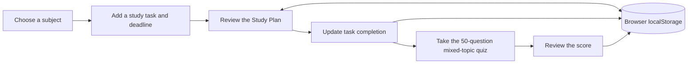

## Documentation

| Area | Purpose |
|---|---|
| [Documentation hub](docs/README.md) | Main navigation for all project records |
| [Project status](docs/PROJECT_STATUS.md) | Ready, pending, blocked, and out-of-scope items |
| [Documentation roadmap](docs/DOCS_ROADMAP.md) | Week 1-16 documentation plan |
| [Contribution ledger](docs/CONTRIBUTION_LEDGER.md) | Member contribution rows and evidence links |
| [Testing documentation](docs/tests/README.md) | Manual testing strategy and proof checklist |
| [Monday status](docs/MONDAY_STATUS.md) | Monday completion snapshot and milestone summary |
| [Monday checklist](docs/MONDAY_CHECKLIST.md) | Task checklist for the Monday progress milestone |
| [Week 6 evidence package](docs/Week6/README.md) | Tested-by note, screenshots, report, and next actions |
| [Week 6 midterm demo path](docs/Week6/MIDTERM_DEMO_PATH.md) | Rehearsal path and fallback proof |
| [Week 6 issue status update](docs/Week6/ISSUE_STATUS_UPDATE.md) | Suggested issue and Definition of Done wording |

---

# Smart Study Companion

A browser-based study planner prototype for organizing class subjects, deadlines, study tasks, and quiz practice.

[Open the prototype](Frontend/index.html) · [Documentation hub](docs/README.md) · [Evidence package](docs/Week6/README.md)

## Overview

Smart Study Companion brings a focused student study workflow into one interface: organize subjects, plan and complete study tasks, and check understanding with a mixed-topic quiz. This is a local browser prototype, not a production service.

## MVP Experience

1. Create or select a subject.
2. Add a study task with a deadline.
3. Open the Study Plan, review tasks, and mark work complete.
4. Take the mixed-topic quiz and review the score.
5. Refresh the page to check browser-local saved data.

| Capability | Current behavior |
|---|---|
| Subjects and tasks | Create subjects and dated tasks; review and update task status. |
| Study Plan | Review pending, overdue, and completed work. |
| Quiz | Answer a 50-question multiple-choice quiz and review the result. |
| Persistence | Keep relevant data in the same browser using localStorage. |

### Study Flow

Study data stays in the current browser profile; it is not synced to a server or another device.

## Architecture

The current implementation is a static frontend; no server or package build is needed to open it.

| Layer | Technology and role |
|---|---|
| Interface | HTML, CSS, and JavaScript provide the subjects/tasks, Study Plan, and quiz views. |
| Browser storage | localStorage keeps app data in the current browser profile; it is not a shared database. |
| Quiz content | Questions are included in the frontend prototype. |

## Quick Start

Open [Frontend/index.html](Frontend/index.html) in a modern browser. No package installation, build command, account, or server setup is required.

## Documentation

| Start here | Purpose |
|---|---|
| [Documentation hub](docs/README.md) | Navigation to project records and weekly documentation. |
| [Project status](docs/PROJECT_STATUS.md) | Current ready, pending, and out-of-scope work. |
| [Testing documentation](docs/tests/README.md) | Manual test strategy and evidence format. |
| [Contribution ledger](docs/CONTRIBUTION_LEDGER.md) | Member contribution rows and linked evidence. |
| [Week 6 evidence package](docs/Week6/README.md) | Demo screenshots, report, tested-by note, and follow-up status. |
| [Midterm demo path](docs/Week6/MIDTERM_DEMO_PATH.md) | Reproducible walkthrough and fallback evidence. |

## Evidence and Current Status

The Week 6 evidence package records the visible app flow. Its screenshot summary marks the main entry, subject/task, quiz, and refresh/persistence demos as passing; the theme/color demo needs a fix.

| Demo | Evidence | Recorded status |
|---|---|---|
| 1 - App entry | [Screenshot](docs/Week6/Demo%201.png) | Pass |
| 2 - Theme and visual consistency | [Screenshot](docs/Week6/Demo2.png) | Needs fix |
| 3 - Subject and task flow | [Screenshot](docs/Week6/Demo%203.png) | Pass |
| 4 - Quiz and results | [Screenshot](docs/Week6/Demo%204.png) | Pass |
| 5 - Persistence after refresh | [Screenshot](docs/Week6/Demo%205.png) | Pass |

See the [Week 6 weekly report](docs/Week6/WEEKLY_REPORT.md) and [tested-by note](docs/Week6/tested-by-notes.md) for test details. Those records do not fully agree on tester identity and contribution confirmation, so treat those details as pending reconciliation. [Issue #23](https://github.com/CapstoneDesign-Fall2026-UlsanCollege/Team-5-Capstone-Design/issues/23) remains open for validation follow-up. The visual fix is tracked in open [Issue #25](https://github.com/CapstoneDesign-Fall2026-UlsanCollege/Team-5-Capstone-Design/issues/25).

## Team Contributions

The [contribution ledger](docs/CONTRIBUTION_LEDGER.md) records five member contribution areas and evidence links. The current enrolled GitHub logins are jn-oli, adronnie, princekark, RaiPrabin697, and liftupkhadka555-spec. Login-to-name mapping and individual evidence receipts should be confirmed against the linked records before treating attribution as complete.

## Current Limitations

- App data is local to one browser profile; there is no login or cross-device synchronization.
- The prototype has no backend, cloud database, reminder service, or mobile packaging.
- The Demo 2 theme/color inconsistency remains open and requires a fix and rerun.
- Screenshots document a focused workflow; they do not establish broader browser compatibility or production readiness.
