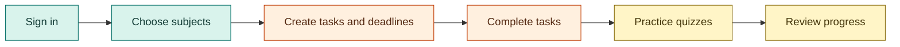
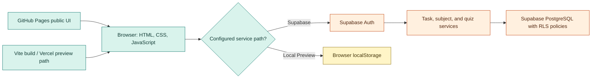

# Smart Study Companion

**Plan your study. Track the work. See what is verified.**

Smart Study Companion helps university students organize subjects, study tasks, deadlines, quizzes, and progress in one browser-based workspace. Team 5 is building a vanilla JavaScript frontend with Supabase Auth and PostgreSQL services. The repository also retains a separate Local Preview path for development; a working screen alone does not establish that data reached Supabase.

[](https://capstonedesign-fall2026-ulsancollege.github.io/Team-5-Capstone-Design/public/index.html) [](docs/week_11/MVP_VERIFICATION_MATRIX.md) [](docs/README.md)

[Open the public app](https://capstonedesign-fall2026-ulsancollege.github.io/Team-5-Capstone-Design/public/index.html) · [Sign in](https://capstonedesign-fall2026-ulsancollege.github.io/Team-5-Capstone-Design/public/auth/login.html) · [Week 11 report](docs/week_11/weekly-report.md) · [Verification matrix](docs/week_11/MVP_VERIFICATION_MATRIX.md) · [Documentation hub](docs/README.md)

## On This Page

[Overview](#overview) · [Quick Links](#quick-links) · [Student Workflow](#student-workflow) · [Architecture](#architecture) · [Current Capabilities](#current-capabilities) · [Local Setup](#local-setup) · [Verification](#verification) · [Team](#team) · [Limitations](#limitations)

## Overview

The first browser prototype used local storage. The current repository adds Supabase-backed authentication, data services, versioned SQL migrations, a Vite build, and automated checks. These are implementation facts, not a blanket claim that every deployed feature or security boundary has passed a live end-to-end test.

For a short review path, read the [shared Week 11 report](docs/week_11/weekly-report.md), then the [MVP verification matrix](docs/week_11/MVP_VERIFICATION_MATRIX.md) and [evidence register](docs/week_11/EVIDENCE_REGISTER.md). They distinguish recorded results from checks that remain pending.

## Quick Links

| Destination | Use |
|---|---|
| [Dashboard and study workspace](https://capstonedesign-fall2026-ulsancollege.github.io/Team-5-Capstone-Design/public/index.html) | Public GitHub Pages interface |
| [Sign up](https://capstonedesign-fall2026-ulsancollege.github.io/Team-5-Capstone-Design/public/auth/signup.html) / [sign in](https://capstonedesign-fall2026-ulsancollege.github.io/Team-5-Capstone-Design/public/auth/login.html) | Student account entry points |
| [Forgot password](https://capstonedesign-fall2026-ulsancollege.github.io/Team-5-Capstone-Design/public/auth/forgot-password.html) / [reset password](https://capstonedesign-fall2026-ulsancollege.github.io/Team-5-Capstone-Design/public/auth/reset-password.html) | Recovery interfaces; delivery and completion need separate verification |
| [Documentation hub](docs/README.md) | Current guidance and historical records |
| [Project status](docs/PROJECT_STATUS.md) / [contribution ledger](docs/CONTRIBUTION_LEDGER.md) | Open work and member evidence |
| [Week 11 report](docs/week_11/weekly-report.md) / [verification matrix](docs/week_11/MVP_VERIFICATION_MATRIX.md) / [evidence register](docs/week_11/EVIDENCE_REGISTER.md) | Expected versus actual results and proof boundaries |

The public URL confirms that the interface is reachable. To assess cloud saves, email delivery, or account isolation, use the linked test receipts rather than the URL alone.

## Student Workflow



Teal marks entry and setup; coral marks study work; gold marks practice and progress.

The task and quiz flows have recorded browser and unit-test evidence in the [matrix](docs/week_11/MVP_VERIFICATION_MATRIX.md). An assisted [November 14 task receipt](docs/week_11/RAI_LIVE_TEST_RECEIPT.md) adds UI-only observations; it is not an independent or server-side isolation test.

## Architecture



Teal is the browser interface; coral is the configured Supabase path; gold is browser-only Local Preview.

The source includes [Supabase client configuration](src/lib/supabase.js), [service modules](src/services/), and [SQL migrations](supabase/migrations/). GitHub Pages is the public link above. The repository also contains a [Vite build](vite.config.js), [Vercel configuration](vercel.json), and a [deployment decision](docs/week_11/FRONTEND_DEPLOYMENT_DECISION.md); a personal-fork Vercel preview is not the same as a confirmed deployment from the team organization.

The Local Preview branch stores data in this browser. It cannot demonstrate multi-device sync or server-side RLS. Even when Supabase is configured, an authenticated two-account read/update/delete denial still requires a recorded live check.

## Current Capabilities

| Area | In the repository | Evidence boundary |
|---|---|---|
| Student accounts | Sign-up, sign-in, verification, and recovery pages under [`public/auth/`](public/auth/) | Recovery email receipt and completed reset are not established by the interface alone. |
| Study planning | Subject selection, task creation, deadlines, completion, and analytics in [`public/app.js`](public/app.js) and [`src/services/`](src/services/) | Task UI and test results are itemized in the [matrix](docs/week_11/MVP_VERIFICATION_MATRIX.md); exact environment matters. |
| Quiz practice | Curated quiz and attempt services, plus AI quiz-related schema and service files | Check [database verification](docs/week_11/DATABASE_AND_RLS_VERIFICATION.md) before claiming the AI tables are live. |
| Data model | [`supabase/setup_all.sql`](supabase/setup_all.sql) and [versioned migrations](supabase/migrations/) | Repository SQL does not prove that every migration is applied to the live project. |
| Protection | RLS policies in the SQL files and an auth guard in [`src/auth-guard.js`](src/auth-guard.js) | Authenticated cross-account API denial remains **Not run** in the [matrix](docs/week_11/MVP_VERIFICATION_MATRIX.md). |

## Local Setup

1. Install Node.js 18 or newer, then run `npm install` and `npm run dev` from the repository root. Vite opens the sign-in page at `http://localhost:3000/auth/login.html`.
2. For a Supabase-backed setup, create a disposable project and configure `VITE_SUPABASE_URL` and `VITE_SUPABASE_ANON_KEY` using [`.env.example`](.env.example). Never place a service-role key, password, or token in a frontend file or commit.
3. Inspect [database verification and migration guidance](docs/week_11/DATABASE_AND_RLS_VERIFICATION.md) before applying SQL. The repository contains migrations beyond `009`, including separate `011` scripts; do not assume that the consolidated script and every versioned migration should be run together or that the live project already has them.
4. Configure the project's Auth Site URL and redirect allow-list for the chosen local or deployed origin before testing verification and recovery links. Check sign-in, task save/read after reload, and a second account using the [independent verification procedure](docs/week_11/INDEPENDENT_VERIFICATION.md).

The frontend source is in [`public/`](public/) and [`src/`](src/). `npm run build` writes the Vite output to `dist/` as configured in [`vite.config.js`](vite.config.js). A local build is not a live-service test.

### Project Directory

```text
Smart Study Companion/
├── public/             # Browser pages, styles, app controller, and auth views
│   ├── auth/           # Sign-in, sign-up, verification, and recovery
│   └── wireframes/     # Design reference views
├── src/                # Supabase client, route guard, and study services
│   ├── lib/
│   └── services/
├── supabase/           # Setup SQL, migrations, functions, and rollbacks
│   ├── migrations/
│   └── functions/
├── tests/              # Unit, database, E2E contract, and browser specs
├── docs/               # Reports, decisions, verification, and handoff
├── .env.example
├── package.json
├── vite.config.js
└── vercel.json
```

## Verification

| Check | Command or record | What it does not prove |
|---|---|---|
| Unit tests | `npm test` | A live Supabase save or browser session |
| Python system checks | `python3 tests/run_tests.py` | Authenticated two-account isolation |
| AI quiz schema checks | `python3 tests/test_ai_quiz.py` | Live AI quiz table availability |
| E2E contract runner | `npm run test:e2e` | Authenticated multi-page Playwright flows |
| Playwright browser E2E | `npm run test:e2e:playwright` | Live multi-student login flows when `E2E_STUDENT_A_*` / `E2E_STUDENT_B_*` credentials are omitted |
| Production bundle | `npm run build` | A successful organization deployment |

See the [Week 11 matrix](docs/week_11/MVP_VERIFICATION_MATRIX.md) for dated results and operators, the [evidence register](docs/week_11/EVIDENCE_REGISTER.md) for proof scope and limits, the [Week 12 Release Verification Report](docs/week_12/RELEASE_VERIFICATION_REPORT.md), and the [Playwright E2E Report](docs/week_12/PLAYWRIGHT_E2E_REPORT.md). In [`tests/e2e/`](tests/e2e/), **24** core Playwright scenarios are defined: the November 22 automated QA run executed **15** cases against local Vite preview (**7 passed, 8 failed, 9 unconfirmed**) due primarily to outdated test selectors, missing mobile navigation steps, strict-mode locator issues, and incomplete assertions; after November 23 script and UI fixes, **12** unauthenticated/live-anon checks and **10** non-cloud mocked UI regression checks passed on Chrome Desktop & Mobile (**22 passed total**), while live authenticated student flows remain **skipped pending test credentials**. Do not treat static checks or mocked runs as proof of live cloud auth or two-student RLS.

## Team

| Student | GitHub login |
|---|---|
| Nabin Khadka | `liftupkhadka555-spec` |
| Sumit Adhikari | `adronnie` |
| Prince Karki | `princekark` |
| Prabin Rai | `RaiPrabin697` |
| J.N. Taj Oli | `jn-oli` |

The [Week 11 shared report](docs/week_11/weekly-report.md) and [contribution ledger](docs/CONTRIBUTION_LEDGER.md) link each member's recorded work. Authorship, browser operation, and independent testing are distinct roles; Prabin's assisted observations are described in his [receipt](docs/week_11/RAI_LIVE_TEST_RECEIPT.md).

## Limitations

- The [feature freeze](docs/week_11/FEATURE_FREEZE_DECISION.md) is **proposed**, not approved by all five members.
- The [database review](docs/week_11/DATABASE_AND_RLS_VERIFICATION.md) still calls for live verification of migrations `009` and `010` and authenticated two-account RLS behavior. UI separation is not proof of server-side denial.
- Live two-student RLS (`DATA-01`), live Supabase migrations `009`/`010`/`012` & Edge Function `generate-ai-quiz`, official course Vercel deployment SHA verification, and credentialed live Playwright browser suites (**15/24** executed Nov 22: **7 PASS / 8 FAIL / 9 unconfirmed**; Nov 23 rerun **22 PASS** unauthenticated/mocked + **40** credential-gated project runs **Skipped**) remain unresolved. Week 12 status stays **NO-GO**.
- Local Preview data stays in browser storage. A GitHub Pages screen or local screenshot cannot by itself prove cloud persistence or multi-device sync.
