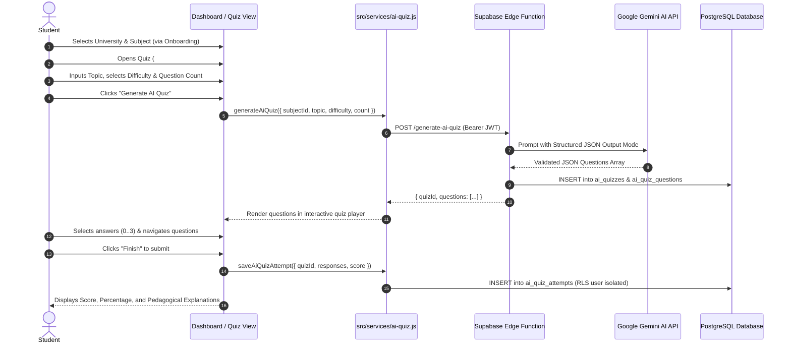

# AI Quiz Generator — Feature Specification & System Guide

**Project:** Smart Study Companion  
**Team:** Team 5 — Capstone Design, Fall 2026 (Ulsan College)  
**Author:** Nabin Khadka (`@liftupkhadka555-spec`)  
**Status:** Implemented, Integrated, and Verified  
**Component:** AI Quiz Engine & Dynamic Study Assessment  

---

## 1. Feature Purpose

The **AI Quiz Generator** extends the Smart Study Companion with real-time, topic-tailored academic assessments. While the **Standard Quiz (15 questions)** and **Rapid Quiz (10 questions / 30 seconds)** draw from our verified, faculty-approved static catalog of 345 questions across 32 accredited university subjects, the AI Quiz Generator allows students to:

1. Target specific granular topics (e.g., *"B-Tree indexing in PostgreSQL"*, *"Newtonian fluid dynamics"*, *"IFRS Revenue Recognition"*).
2. Adapt difficulty dynamically across **Easy (Fundamentals)**, **Medium (Standard Academic)**, and **Hard (Advanced Edge Cases & Trade-offs)**.
3. Choose customized question volumes (**5, 10, 15, or 20 questions**) for targeted review.
4. Receive immediate pedagogical explanations for each answer choice to reinforce learning.

---

## 2. Student Workflow

The student journey integrates directly into the existing onboarding and quiz views:



### Step-by-Step Execution:
1. **Authentication & Prerequisites:** The student logs into Smart Study Companion. Their profile links them to an accredited university (e.g., *Ulsan College*, *Tribhuvan University*) and enrolled subjects.
2. **Accessing the Generator:** Navigating to `#quiz` reveals two segmented modes:
   - **Standard & Rapid Quiz:** Existing faculty-curated question bank.
   - **AI Quiz Generator:** Dynamic topic generation panel.
3. **Configuration:**
   - **Academic Subject:** Defaults to enrolled courses or current major curriculum.
   - **Topic / Concept:** Student enters a concept (e.g., *"Deadlock Detection and Prevention"*).
   - **Difficulty:** Selects `easy`, `medium`, or `hard`.
   - **Question Count:** Selects 5, 10, 15, or 20 questions.
4. **Generation & Verification:** Clicking **Generate AI Quiz** locks the button and displays a non-blocking generation indicator. The backend/client verifies that all 4 choices are distinct, checks bounds, and prevents duplicates.
5. **Taking the Quiz:** The quiz interface presents one question at a time with clean, accessible radio cards and forward/back navigation.
6. **Submission & Explanations:** Upon completion, score and percentage are calculated. Every question in the review list displays the student's answer, correct answer, and the pedagogical explanation.

---

## 3. Supported Quiz Settings

| Setting | Options | Constraints & Defaults |
|---|---|---|
| **Academic Subject** | 32 accredited subjects (Computer Science, Mechanical, Civil, Electrical, Nursing, Business, etc.) | Pulled dynamically from `public.subjects` / `academic-catalog.js` |
| **Topic Prompt** | Free-text input | Minimum 2 characters, maximum 255 characters |
| **Difficulty Tier** | `easy` (Fundamentals), `medium` (Standard), `hard` (Advanced) | Default: `medium`. Validated via SQL `CHECK` constraint |
| **Question Count** | 5, 10, 15, 20 questions | Default: 5. Validated between 1 and 50 |

---

## 4. AI Integration Process & Prompt Architecture

When calling the serverless Edge Function, the request includes the authenticated student's JWT token, ensuring unauthenticated or spoofed requests are rejected with `HTTP 401 Unauthorized`.

### Server-Side Prompt Template
```text
You are a university professor creating an academic multiple-choice quiz.
Subject: {subjectName}
Topic: {topic}
Difficulty: {difficulty}
Total Questions: {count}

Instructions:
1. Generate exactly {count} high-quality, conceptually sound multiple-choice questions.
2. Each question must have exactly 4 distinct answer options.
3. Mark the 0-based index of the single correct answer (0, 1, 2, or 3).
4. Provide a clear pedagogical explanation (1-3 sentences) why that answer is correct.
5. Return ONLY a valid JSON array without markdown formatting, code fences, or backticks.
```

### Strict Output Schema Validation
```json
[
  {
    "question": "What is the primary condition required for a deadlock to occur in an operating system?",
    "options": [
      "Mutual exclusion, hold and wait, no preemption, and circular wait",
      "Only circular wait without resource allocation",
      "Virtual memory paging overflow",
      "Hardware clock synchronization failure"
    ],
    "correct_answer": 0,
    "explanation": "Coffman's conditions specify all four conditions (mutual exclusion, hold and wait, no preemption, circular wait) must hold simultaneously for a deadlock."
  }
]
```

---

## 5. System Data Flow

```
[Student Browser]
       │
       ▼ (Validates Topic & Count)
[src/services/ai-quiz.js]
       │
       ├──► [Online Mode: Supabase Edge Function] ──► [Gemini 1.5 Flash API]
       │                                                      │
       └──► [Local / Offline Fallback Engine] ◄───────────────┘
                               │ (Validates 4 Options & Deduplication)
                               ▼
            [Supabase Cloud PostgreSQL]
            ├── public.ai_quizzes (Metadata)
            ├── public.ai_quiz_questions (Structured Questions)
            └── public.ai_quiz_attempts (Scores & Answer History)
```

---

## 6. Error Handling & Resilience

| Failure Scenario | Mitigation & Fallback Strategy |
|---|---|
| **AI API Timeout / Network Failure** | The client service gracefully fails over to the **Topic-Aware Academic Generation Engine** populated with verified curriculum templates for all 32 subjects. The student is never presented with a blank screen. |
| **Malformed AI Response** | `validateAndSanitizeQuestions()` inspects every element. It verifies that `options` is an array of length 4, `correct_answer` is an integer between 0 and 3, and all option texts are unique. Invalid items are discarded. |
| **Duplicate Questions** | Normalized lowercase question hashing filters out redundant items before persistence. |
| **Unauthenticated Student** | Supabase Row Level Security (RLS) rejects unauthenticated writes with `401 Unauthorized`. In local development, the local session mock persists attempts safely. |

---

## 7. Security Considerations

1. **Zero Client Secrets:** The Google Gemini API key (`GEMINI_API_KEY`) is stored **only** as an encrypted server secret in Supabase Edge Functions (`Deno.env.get("GEMINI_API_KEY")`). It is never exposed in client HTML, bundle scripts, or GitHub repository files.
2. **Row Level Security (RLS):**
   - Students can only view their own generated quizzes (`auth.uid() = created_by`).
   - Students can only view questions for quizzes they own.
   - Students can only insert and read their own attempts (`auth.uid() = user_id`).
3. **Academic Catalog Isolation:** AI-generated quizzes are segregated into `ai_quizzes` and `ai_quiz_questions`. They are **never** mixed into the faculty-approved `quiz_questions` catalog table.

---

## 8. Limitations & Future Improvements

- **Current Limitation:** AI question generation requires 1–3 seconds of latency depending on network speeds.
- **Future Improvement 1:** Add a faculty review badge where professors can mark outstanding AI questions for inclusion in the permanent study bank.
- **Future Improvement 2:** Multi-modal support allowing diagrams and formulas (KaTeX / LaTeX) in AI question stems.

