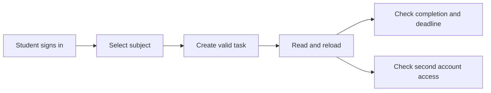
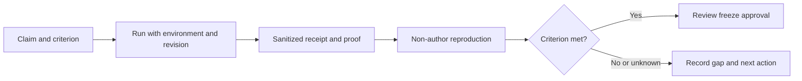

# Smart Study Companion Documentation

## Current review - Week 11

Prepared 2026-11-14. [Week 11 report](week_11/weekly-report.md) separates historical receipts from current checks. Core workflow: sign in, create a task, reject invalid input, reload and verify account isolation. Fresh live/RLS and independent reproduction remain Not run; freeze approval is pending.

**Read first:** [Shared report](week_11/weekly-report.md) → [Verification matrix](week_11/MVP_VERIFICATION_MATRIX.md) → [Freeze decision](week_11/FREEZE_DECISION.md) → [Ownership update](week_10/AI_USE_AND_CODE_OWNERSHIP_AUDIT.md#week-11-reconciliation-2026-11-14).

### Project Review

[Package index](week_11/README.md), [scope contract](week_11/FREEZE_DECISION.md), [risk register](week_11/DEFECT_AND_RISK_REGISTER.md), [quality review](week_11/SPRINT_QUALITY_REVIEW.md).

### Testing and Evidence

[Evidence register](week_11/EVIDENCE_REGISTER.md), [verification matrix](week_11/MVP_VERIFICATION_MATRIX.md), [independent check](week_11/INDEPENDENT_VERIFICATION.md). Unit, browser, live-service and independent results have different proof boundaries.

### Setup and Handoff

[Current setup](week5/SETUP_INSTRUCTIONS.md#current-application-setup-2026-11-14), [architecture](week_10/backend-architecture.md#week-11-current-task-boundary), [handoff](week_11/INDEPENDENT_VERIFICATION.md), [demo runbook](week_11/DEMO_RUNBOOK.md).

The diagrams describe the intended workflow and review process, not completed tests.

## Historical navigation snapshot

The original hub below is retained. Its dates and "current" labels describe its historical snapshot; use the Week 11 routes above for the present review.

**Team:** Team 5  
**Term:** Fall 2026  **Last updated:** 2026-11-04

This folder is the project documentation hub. It keeps weekly records, testing evidence, decision notes, demo planning, and handoff material in one place.

## Start Here

| Document | Use it for |
|---|---|
| [Project status](PROJECT_STATUS.md) | Current ready, pending, blocked, and out-of-scope items |
| [Documentation roadmap](DOCS_ROADMAP.md) | Week 1-16 documentation plan |
| [Contribution ledger](CONTRIBUTION_LEDGER.md) | Member rows and evidence links |
| [Testing documentation](tests/README.md) | Manual testing strategy and proof checklist |
| [Week 6 evidence package](Week6/README.md) | Tested-by note, screenshots, report, and next actions |
| [Week 6 midterm demo path](Week6/MIDTERM_DEMO_PATH.md) | Rehearsal path and fallback proof |
| [Week 6 issue status update](Week6/ISSUE_STATUS_UPDATE.md) | Suggested issue and Definition of Done updates |

## Weekly Records

| Week | Focus | Key links |
|---|---|---|
| Week 1 | Project launch and agreement | [Week 1 index](week1/README.md) |
| Week 2 | Scope, user flow, research receipts | [Week 2 index](week2/README.md) |
| Week 3 | Candidate vertical slice and wireframes | [Week 3 index](week3/README.md) |
| Week 4 | Checkpoint and stack decision | [Week 4 index](week4/README.md) |
| Week 5 | Vertical-slice worklist and test planning | [Week 5 index](week5/README.md) |
| Week 6 | Tested-by evidence package and midterm readiness | [Week 6 index](Week6/README.md) |
| Week 8 | Post-midterm lesson and personal evidence update | [Week 8 weekly report](week8/weekly-report.md) |
| Week 8 | Login/signup feature proposal | [Login & Signup Feature Suggestions](week8/login_signup_feature_suggestions.md) |
| Week 9 | Supabase migration, QA matrix, and demo roadmap | [Week 9 weekly report](week9/weekly-report.md) |
| Week 10 | Own a Slice, Steward an Area & Study Task Analytics | [Week 10 weekly report](week_10/weekly-report.md) · [Week 10 Slice.md](week_10/Slice.md) · [Full-Stack Changes Model](week_10/FULL_STACK_CHANGES_MODEL.md) |

## Current Evidence Trail

| Evidence type | Current link | Status |
|---|---|---|
| Runnable prototype | [Frontend prototype](../Frontend/index.html) | Available locally |
| Wireframes | [Wireframe index](../Frontend/wireframes/index.html) | Available locally |
| Manual testing strategy | [Testing docs](tests/README.md) | Prepared |
| Week 6 tested-by note | [Tested-by note](Week6/tested-by-notes.md) | Tested with screenshot proof; theme issue open |
| Week 6 weekly report | [Weekly report](Week6/WEEKLY_REPORT.md) | Updated for evidence review |
| Midterm demo path | [Midterm demo path](Week6/MIDTERM_DEMO_PATH.md) | Ready for rehearsal |
| Contribution tracking | [Contribution ledger](CONTRIBUTION_LEDGER.md) | Ready for weekly updates |

## Documentation Rules

- Record only evidence that exists in the repository, a commit, a pull request, an issue, or an attached proof link.
- Keep pending work marked as pending until the test or proof is actually complete.
- If a test is not run, write `Not run` and explain what is missing.
- Use the root [README](../README.md) for the public project summary and this file for deeper navigation.

## Week 9 evidence and demo planning

| Document | Use it for |
|---|---|
| [Week 9 shared report](week9/weekly-report.md) | Current documented artifacts, test boundaries, blockers, and RaiPrabin697’s personal documentation record |
| [Week 9 QA Evidence Matrix](week9/QA_EVIDENCE_MATRIX.md) | Result labels and repeatable auth, task-persistence, browser, and isolation checks; unrun cases remain marked |
| [Week 9 Final Demo Roadmap](week9/FINAL_DEMO_ROADMAP.md) | Demo journey, acceptance evidence, and fallback criteria |

The new Week 9 matrix and roadmap are planning/evidence documents; they do not indicate that a fresh live test has been performed.
