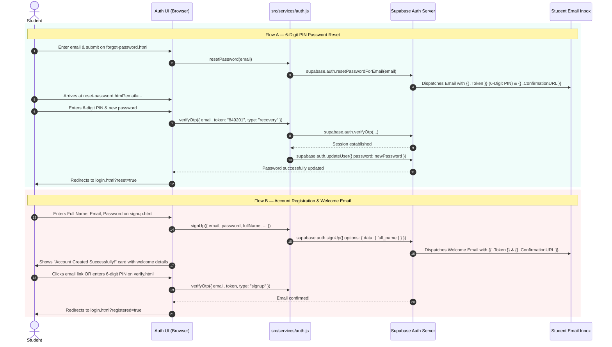

# Supabase Auth Email Templates & 6-Digit OTP Setup Guide

**Project:** Smart Study Companion  
**Team:** Team 5 — Capstone Design  
**Target Supabase Project:** `https://bcwwnjtmrcxggbaallon.supabase.co`  
**Date:** Week 10

---

## 1. Executive Summary & Root Cause Analysis

### Problem 1: Password Reset Only Sends a Link, No 6-Digit PIN
* **Root Cause:** By default, Supabase's email template for **Reset Password** only contains the link variable:
  ```html
  <p><a href="{{ .ConfirmationURL }}">Reset Password</a></p>
  ```
  Supabase uses a Go-based template engine. In Supabase, the **6-digit numeric OTP code** is stored in the variable `{{ .Token }}`. Because `{{ .Token }}` is omitted from Supabase's default email template, Supabase dispatches an email with **only the URL link** and **no 6-digit PIN**!
* **Resolution:** Update the Supabase **Reset Password** email template to include `{{ .Token }}` in a prominent 6-digit PIN box.

---

### Problem 2: Account Creation Does Not Send a Proper Welcome Message
* **Root Cause:** The default Supabase **Confirm signup** email is a bare 2-line message without welcome branding, student personalization, or application onboarding information. Furthermore, if the "Confirm email" setting is toggled off in the Supabase dashboard, Supabase skips email delivery entirely upon signup.
* **Resolution:**
  1. Ensure **"Confirm email"** is enabled in **Authentication $\rightarrow$ Providers $\rightarrow$ Email**.
  2. Update the **Confirm signup** template to a branded **Welcome & Student Confirmation Email** featuring the student's name (`{{ .Data.full_name }}`), registered email (`{{ .Email }}`), the 6-digit confirmation PIN (`{{ .Token }}`), and a one-click confirmation link (`{{ .ConfirmationURL }}`).

---

## 2. Supabase Dashboard Configuration Steps

### Step 1: Open Your Supabase Dashboard
1. Navigate to: [https://supabase.com/dashboard/project/bcwwnjtmrcxggbaallon](https://supabase.com/dashboard/project/bcwwnjtmrcxggbaallon)
2. In the left navigation menu, click **Authentication** (the user icon).

---

### Step 2: Configure "Reset Password" Email Template (To Send the 6-Digit PIN)
1. In the Authentication sidebar, click **Email Templates**.
2. Select the **Reset Password** tab.
3. Set the **Subject line**:
   ```text
   Your 6-Digit Password Reset Code — Smart Study Companion
   ```
4. In the **Body** editor, paste the following HTML template and click **Save**:

```html
<!DOCTYPE html>
<html lang="en">
<head>
  <meta charset="utf-8">
  <meta name="viewport" content="width=device-width, initial-scale=1.0">
  <title>Reset Password — Smart Study Companion</title>
</head>
<body style="font-family: -apple-system, BlinkMacSystemFont, 'Segoe UI', Roboto, Helvetica, Arial, sans-serif; background-color: #f3eee4; margin: 0; padding: 32px 16px; color: #1c1915;">
  <table role="presentation" width="100%" cellspacing="0" cellpadding="0" style="max-width: 580px; margin: 0 auto; background-color: #ffffff; border-radius: 20px; box-shadow: 0 12px 36px rgba(28, 25, 21, 0.08); overflow: hidden; border: 1px solid rgba(28, 25, 21, 0.08);">
    <!-- Header -->
    <tr>
      <td style="background-color: #17211f; padding: 28px 32px; text-align: center;">
        <div style="display: inline-block; width: 44px; height: 44px; line-height: 44px; border-radius: 12px; background: linear-gradient(160deg, #2dd4bf, #0f766e); color: #042f2e; font-size: 22px; font-weight: bold; margin-bottom: 8px;">
          🎓
        </div>
        <p style="margin: 0; font-size: 11px; letter-spacing: 0.16em; text-transform: uppercase; color: #efe7d8; opacity: 0.7;">Companion</p>
        <h1 style="margin: 4px 0 0 0; font-size: 24px; font-weight: 700; color: #efe7d8; font-family: Georgia, serif;">StudySmart</h1>
      </td>
    </tr>

    <!-- Body -->
    <tr>
      <td style="padding: 36px 32px;">
        <h2 style="margin: 0 0 12px 0; font-size: 22px; font-weight: 700; color: #1c1915;">Password Reset Request</h2>
        <p style="margin: 0 0 20px 0; font-size: 15px; line-height: 1.6; color: #6b6458;">
          We received a request to reset the password for your student account (<strong>{{ .Email }}</strong>).
        </p>

        <!-- 6-digit PIN Box -->
        <div style="background-color: #f0fdfa; border: 2px dashed #0f766e; border-radius: 14px; padding: 22px; text-align: center; margin: 28px 0;">
          <span style="display: block; font-size: 12px; font-weight: 700; letter-spacing: 0.14em; text-transform: uppercase; color: #0f766e; margin-bottom: 8px;">
            Your 6-Digit Verification PIN
          </span>
          <span style="font-family: ui-monospace, SFMono-Regular, Menlo, Monaco, Consolas, monospace; font-size: 38px; font-weight: 800; letter-spacing: 10px; color: #0f766e; display: inline-block;">
            {{ .Token }}
          </span>
        </div>

        <p style="margin: 0 0 24px 0; font-size: 14px; line-height: 1.6; color: #6b6458; text-align: center;">
          Enter this 6-digit code on the reset password page, or click the direct button below:
        </p>

        <!-- Direct Link Button -->
        <table role="presentation" width="100%" cellspacing="0" cellpadding="0">
          <tr>
            <td align="center">
              <a href="{{ .ConfirmationURL }}" style="display: inline-block; background-color: #0f766e; color: #ffffff; padding: 14px 32px; border-radius: 12px; font-size: 15px; font-weight: 600; text-decoration: none; box-shadow: 0 4px 14px rgba(15, 118, 110, 0.35);">
                Reset Password Directly
              </a>
            </td>
          </tr>
        </table>

        <!-- Security Notice -->
        <div style="margin-top: 32px; padding-top: 20px; border-top: 1px solid rgba(28, 25, 21, 0.08);">
          <p style="margin: 0; font-size: 12px; line-height: 1.5; color: #9c9488;">
            ⏱ This 6-digit PIN and recovery link will expire in 1 hour.<br>
            🔒 If you did not request a password reset, please ignore this email or review your account security.
          </p>
        </div>
      </td>
    </tr>

    <!-- Footer -->
    <tr>
      <td style="background-color: #faf7f2; padding: 20px 32px; text-align: center; border-top: 1px solid rgba(28, 25, 21, 0.06);">
        <p style="margin: 0; font-size: 12px; color: #9c9488;">
          Smart Study Companion — Team 5 Capstone Design Project &copy; 2026
        </p>
      </td>
    </tr>
  </table>
</body>
</html>
```

---

### Step 3: Configure "Confirm signup" Email Template (Welcome & Confirmation)
1. In the Authentication sidebar under **Email Templates**, select the **Confirm signup** tab.
2. Set the **Subject line**:
   ```text
   Welcome to Smart Study Companion — Confirm Your Student Account
   ```
3. In the **Body** editor, paste the following HTML template and click **Save**:

```html
<!DOCTYPE html>
<html lang="en">
<head>
  <meta charset="utf-8">
  <meta name="viewport" content="width=device-width, initial-scale=1.0">
  <title>Welcome to Smart Study Companion</title>
</head>
<body style="font-family: -apple-system, BlinkMacSystemFont, 'Segoe UI', Roboto, Helvetica, Arial, sans-serif; background-color: #f3eee4; margin: 0; padding: 32px 16px; color: #1c1915;">
  <table role="presentation" width="100%" cellspacing="0" cellpadding="0" style="max-width: 580px; margin: 0 auto; background-color: #ffffff; border-radius: 20px; box-shadow: 0 12px 36px rgba(28, 25, 21, 0.08); overflow: hidden; border: 1px solid rgba(28, 25, 21, 0.08);">
    <!-- Header -->
    <tr>
      <td style="background-color: #17211f; padding: 28px 32px; text-align: center;">
        <div style="display: inline-block; width: 44px; height: 44px; line-height: 44px; border-radius: 12px; background: linear-gradient(160deg, #2dd4bf, #0f766e); color: #042f2e; font-size: 22px; font-weight: bold; margin-bottom: 8px;">
          🎓
        </div>
        <p style="margin: 0; font-size: 11px; letter-spacing: 0.16em; text-transform: uppercase; color: #efe7d8; opacity: 0.7;">Companion</p>
        <h1 style="margin: 4px 0 0 0; font-size: 24px; font-weight: 700; color: #efe7d8; font-family: Georgia, serif;">StudySmart</h1>
      </td>
    </tr>

    <!-- Body -->
    <tr>
      <td style="padding: 36px 32px;">
        <h2 style="margin: 0 0 12px 0; font-size: 22px; font-weight: 700; color: #1c1915;">Account Created Successfully! 🎉</h2>
        <p style="margin: 0 0 16px 0; font-size: 15px; line-height: 1.6; color: #6b6458;">
          Welcome to <strong>Smart Study Companion</strong>! Your student account has been registered for <strong>{{ .Email }}</strong>.
        </p>
        <p style="margin: 0 0 20px 0; font-size: 15px; line-height: 1.6; color: #6b6458;">
          To complete your setup and unlock your academic workspace, please verify your email address:
        </p>

        <!-- 6-digit Code Box -->
        <div style="background-color: #f0fdfa; border: 2px dashed #0f766e; border-radius: 14px; padding: 22px; text-align: center; margin: 24px 0;">
          <span style="display: block; font-size: 12px; font-weight: 700; letter-spacing: 0.14em; text-transform: uppercase; color: #0f766e; margin-bottom: 8px;">
            Your 6-Digit Confirmation PIN
          </span>
          <span style="font-family: ui-monospace, SFMono-Regular, Menlo, Monaco, Consolas, monospace; font-size: 38px; font-weight: 800; letter-spacing: 10px; color: #0f766e; display: inline-block;">
            {{ .Token }}
          </span>
        </div>

        <!-- Direct Link Button -->
        <table role="presentation" width="100%" cellspacing="0" cellpadding="0" style="margin-bottom: 24px;">
          <tr>
            <td align="center">
              <a href="{{ .ConfirmationURL }}" style="display: inline-block; background-color: #0f766e; color: #ffffff; padding: 14px 32px; border-radius: 12px; font-size: 15px; font-weight: 600; text-decoration: none; box-shadow: 0 4px 14px rgba(15, 118, 110, 0.35);">
                Confirm My Student Account
              </a>
            </td>
          </tr>
        </table>

        <!-- Features Checklist -->
        <div style="background-color: #faf7f2; border-radius: 14px; padding: 18px 20px; margin: 24px 0;">
          <p style="margin: 0 0 8px 0; font-size: 13px; font-weight: 700; color: #1c1915;">
            📚 Once confirmed, you can:
          </p>
          <ul style="margin: 0; padding-left: 20px; font-size: 13px; color: #6b6458; line-height: 1.6;">
            <li>Select your University &amp; Major Curriculum</li>
            <li>Organize assignments and study deadlines in Task Manager</li>
            <li>Practice 345+ Verified Standard &amp; Rapid Quizzes</li>
            <li>Generate personalized AI Quizzes tailored to your topics</li>
          </ul>
        </div>

        <p style="margin: 0; font-size: 12px; line-height: 1.5; color: #9c9488;">
          If you did not sign up for Smart Study Companion, you can safely ignore this email.
        </p>
      </td>
    </tr>

    <!-- Footer -->
    <tr>
      <td style="background-color: #faf7f2; padding: 20px 32px; text-align: center; border-top: 1px solid rgba(28, 25, 21, 0.06);">
        <p style="margin: 0; font-size: 12px; color: #9c9488;">
          Smart Study Companion — Team 5 Capstone Design Project &copy; 2026
        </p>
      </td>
    </tr>
  </table>
</body>
</html>
```

---

### Step 4: Verify "Confirm email" Provider Setting
1. In the left navigation menu, go to **Authentication** $\rightarrow$ **Providers**.
2. Click on the **Email** provider accordion to expand it.
3. Make sure **"Confirm email"** is toggled **ON** (enabled):
   - When **Confirm email** is enabled, Supabase triggers the **Confirm signup** welcome email automatically every time a student registers.
   - If **Confirm email** is turned off, Supabase marks the user confirmed immediately without sending an email.
4. Click **Save** at the bottom.

---

## 3. Full-Stack Workflow Verification



---

## 4. Codebase Architecture Checklist

| Component | File Path | Status | Verification |
| :--- | :--- | :--- | :--- |
| **Auth Service** | `src/services/auth.js` | Updated | Clean `token.replace(/\D/g, '')` sanitization & `resendPasswordReset()` |
| **Public Auth Service** | `public/src/services/auth.js` | Updated | Synchronized with `src/services/auth.js` |
| **Reset Password UI** | `public/auth/reset-password.html` | Updated | Prominent 6-digit PIN input with "Resend code" button & countdown |
| **Forgot Password UI** | `public/auth/forgot-password.html` | Updated | Immediate guidance & 1-click continuation to enter 6-digit PIN |
| **Signup UI** | `public/auth/signup.html` | Updated | On-page success confirmation card with welcome message & email display |
| **Verify UI** | `public/auth/verify.html` | Updated | Dual verification: automatic link detection + 6-digit confirmation PIN form |
| **Auth Controller** | `public/auth/auth-init.js` | Updated | Handles 6-digit OTP verification for both recovery and signup |
| **Styling** | `public/auth/auth.css` | Updated | Monospace `.otp-input`, `.auth-link-btn`, and info cards |
| **Automated Tests** | `tests/run_tests.py` | Passing | 11/11 automated tests verified with OTP sanitization checks |

