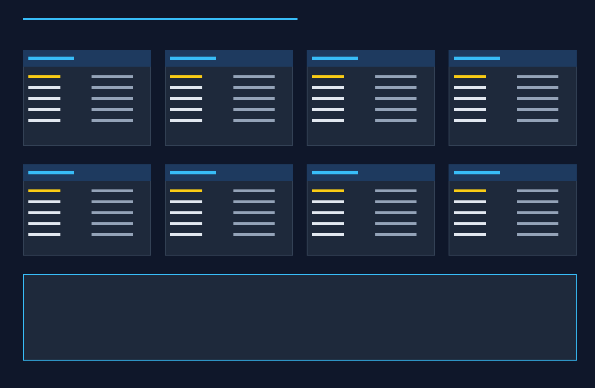
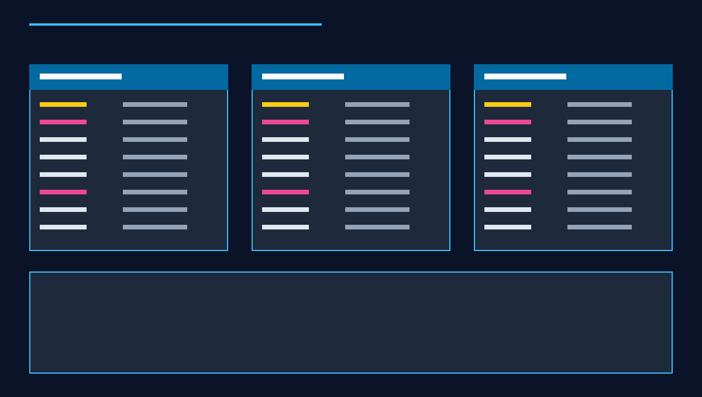

# AI Quiz Database Specification & Integration Guide

**Project:** Smart Study Companion  
**Team:** Team 5 — Capstone Design, Fall 2026 (Ulsan College)  
**Database Provider:** Supabase Cloud PostgreSQL (AWS `ap-northeast-2`)  
**Instance Host:** `https://bcwwnjtmrcxggbaallon.supabase.co`  
**Schema Migration:** `supabase/migrations/009_ai_quiz_tables.sql`  

---

## 1. Overview of Database Architecture

Smart Study Companion operates on a normalized PostgreSQL database hosted on Supabase Cloud. Student data isolation is strictly enforced at the database engine level via **PostgreSQL Row Level Security (RLS)**.

```
+-----------------------------------------------------------------------------------+
|                        Supabase Cloud PostgreSQL Database                         |
|                                                                                   |
|  [Core Catalog Tables]            [Core Student Data]       [AI Quiz Extension]   |
|  - universities (46 records)      - profiles (RLS)          - ai_quizzes (RLS)    |
|  - subjects (32 records)          - tasks (RLS)             - ai_quiz_questions   |
|  - major_subjects (128 records)   - student_subjects (RLS)  - ai_quiz_attempts    |
|  - quiz_questions (345 records)   - quiz_attempts (RLS)                           |
+-----------------------------------------------------------------------------------+
```

---

## 2. Existing Database Tables Reference

The production database contains 8 verified core tables created across migrations `001` through `008`:



| Table Name | Description | Key Columns | Primary / Foreign Keys | RLS Active |
|---|---|---|---|---|
| `public.profiles` | Student profile & academic placement | `id`, `full_name`, `university`, `faculty`, `major`, `onboarding_completed` | `PK: id` $\rightarrow$ `auth.users(id)` | **YES** |
| `public.subjects` | Accredited courses catalog | `id`, `name`, `slug`, `icon`, `category`, `is_default` | `PK: id`, `UNIQUE: name, slug` | **YES** (Read-all) |
| `public.universities` | Accredited universities catalog | `id`, `country`, `name`, `code`, `is_accredited` | `PK: id` | **YES** (Read-all) |
| `public.major_subjects` | Degree program curricula | `id`, `major`, `subject_id`, `is_core`, `semester` | `PK: id`, `FK: subject_id` $\rightarrow$ `subjects(id)` | **YES** (Read-all) |
| `public.student_subjects` | Student course enrollments | `id`, `student_id`, `subject_id`, `enrolled_at` | `PK: id`, `FK: student_id`, `FK: subject_id` | **YES** (Own user) |
| `public.tasks` | Study tasks and deadlines | `id`, `student_id`, `subject_id`, `title`, `deadline`, `completed` | `PK: id`, `FK: student_id`, `FK: subject_id` | **YES** (Own user) |
| `public.quiz_questions` | Verified faculty question bank (345 Qs) | `id`, `subject_id`, `question`, `options`, `correct_answer`, `explanation` | `PK: id`, `FK: subject_id` | **YES** (Read-all) |
| `public.quiz_attempts` | Standard & Rapid quiz attempts | `id`, `student_id`, `subject_id`, `mode`, `score`, `total_questions` | `PK: id`, `FK: student_id`, `FK: subject_id` | **YES** (Own user) |

---

## 3. Newly Added AI Quiz Tables (Migration 009)

To support topic-tailored AI quizzes without polluting the verified static question bank, Migration `009_ai_quiz_tables.sql` introduces 3 normalized tables:



### Table 1: `public.ai_quizzes`
Stores configuration and session metadata for an AI-generated quiz.

| Column | Type | Constraints | Description |
|---|---|---|---|
| `id` | `UUID` | `PRIMARY KEY DEFAULT gen_random_uuid()` | Unique quiz identifier |
| `subject_id` | `UUID` | `NOT NULL REFERENCES subjects(id) ON DELETE CASCADE` | Associated academic subject |
| `topic` | `VARCHAR(255)` | `NOT NULL` | Concept or prompt entered by student |
| `difficulty` | `VARCHAR(20)` | `NOT NULL DEFAULT 'medium' CHECK (difficulty IN ('easy', 'medium', 'hard'))` | Difficulty tier |
| `question_count` | `INT` | `NOT NULL DEFAULT 5 CHECK (question_count BETWEEN 1 AND 50)` | Number of generated questions |
| `created_by` | `UUID` | `NOT NULL REFERENCES profiles(id) ON DELETE CASCADE` | Creator student profile |
| `status` | `VARCHAR(50)` | `NOT NULL DEFAULT 'completed' CHECK (status IN ('generating', 'completed', 'failed'))` | Generation status |
| `created_at` | `TIMESTAMPTZ` | `NOT NULL DEFAULT now()` | Generation timestamp |
| `updated_at` | `TIMESTAMPTZ` | `NOT NULL DEFAULT now()` | Last update timestamp |

### Table 2: `public.ai_quiz_questions`
Stores individual multiple-choice questions belonging to an AI quiz session.

| Column | Type | Constraints | Description |
|---|---|---|---|
| `id` | `UUID` | `PRIMARY KEY DEFAULT gen_random_uuid()` | Unique question identifier |
| `ai_quiz_id` | `UUID` | `NOT NULL REFERENCES ai_quizzes(id) ON DELETE CASCADE` | Parent AI quiz reference |
| `question_text` | `TEXT` | `NOT NULL` | Full question prompt stem |
| `options` | `JSONB` | `NOT NULL` | Array of exactly 4 string answer choices |
| `correct_answer` | `INT` | `NOT NULL CHECK (correct_answer BETWEEN 0 AND 3)` | 0-based index of correct option |
| `explanation` | `TEXT` | `NULL` | Pedagogical rationale for correct answer |
| `question_order` | `INT` | `NOT NULL DEFAULT 1` | 1-based order within quiz |
| `created_at` | `TIMESTAMPTZ` | `NOT NULL DEFAULT now()` | Question creation timestamp |

### Table 3: `public.ai_quiz_attempts`
Records student quiz submissions, scores, and full answer histories.

| Column | Type | Constraints | Description |
|---|---|---|---|
| `id` | `UUID` | `PRIMARY KEY DEFAULT gen_random_uuid()` | Unique attempt record identifier |
| `ai_quiz_id` | `UUID` | `NOT NULL REFERENCES ai_quizzes(id) ON DELETE CASCADE` | AI quiz reference |
| `user_id` | `UUID` | `NOT NULL REFERENCES profiles(id) ON DELETE CASCADE` | Student profile reference |
| `submitted_answers` | `JSONB` | `NOT NULL DEFAULT '[]'::jsonb` | Array: `[{ question_id, selected_answer, is_correct }]` |
| `score` | `INT` | `NOT NULL DEFAULT 0` | Total correct answers |
| `total_questions` | `INT` | `NOT NULL` | Total questions in attempt |
| `percentage` | `INT` | `GENERATED ALWAYS AS (ROUND((score / total_questions) * 100)) STORED` | Percentage score (0..100) |
| `time_spent_seconds` | `INT` | `NULL` | Time elapsed in seconds |
| `started_at` | `TIMESTAMPTZ` | `NOT NULL DEFAULT now()` | Start timestamp |
| `completed_at` | `TIMESTAMPTZ` | `NOT NULL DEFAULT now()` | Submission timestamp |

---

## 4. Row Level Security (RLS) Policies

All three AI Quiz tables enable PostgreSQL RLS:

```sql
ALTER TABLE public.ai_quizzes ENABLE ROW LEVEL SECURITY;
ALTER TABLE public.ai_quiz_questions ENABLE ROW LEVEL SECURITY;
ALTER TABLE public.ai_quiz_attempts ENABLE ROW LEVEL SECURITY;
```

### Security Policy Rules:
1. **`ai_quizzes` Policy:**
   - `SELECT`, `INSERT`, `UPDATE`, `DELETE`: Restricted to rows where `auth.uid() = created_by`.
2. **`ai_quiz_questions` Policy:**
   - `SELECT`: A user can read questions only if they own the parent quiz:
     ```sql
     EXISTS (
         SELECT 1 FROM ai_quizzes
         WHERE ai_quizzes.id = ai_quiz_questions.ai_quiz_id
           AND ai_quizzes.created_by = auth.uid()
     )
     ```
3. **`ai_quiz_attempts` Policy:**
   - `SELECT`, `INSERT`, `UPDATE`: Restricted to rows where `auth.uid() = user_id`.

---

## 5. Migration Instructions

Developers can deploy the AI Quiz schema to any Supabase project using either of two methods:

### Method A: Consolidated 1-Click Deployment (Recommended)
1. Open the [Supabase SQL Editor](https://supabase.com/dashboard/project/bcwwnjtmrcxggbaallon/sql/new).
2. Copy and paste the complete [`supabase/setup_all.sql`](../../supabase/setup_all.sql) script.
3. Click **Run**. All 9 tables, triggers, and policies will be applied idempotently.

### Method B: Incremental Versioned Migration
1. In the Supabase SQL Editor, run [`supabase/migrations/009_ai_quiz_tables.sql`](../../supabase/migrations/009_ai_quiz_tables.sql).
2. Check that the command returns `Success. No rows returned`.

---

## 6. Manual Screenshot Capture Guidelines for Developers

For capstone presentation slide decks:
1. Open the **Supabase Dashboard** $\rightarrow$ **Table Editor**.
2. Select `ai_quizzes`, `ai_quiz_questions`, and `ai_quiz_attempts`.
3. Capture the browser window showing the active table schema, column types, and RLS badge.
4. Redact any sensitive API keys or student email addresses before committing images to `docs/database/images/`.
