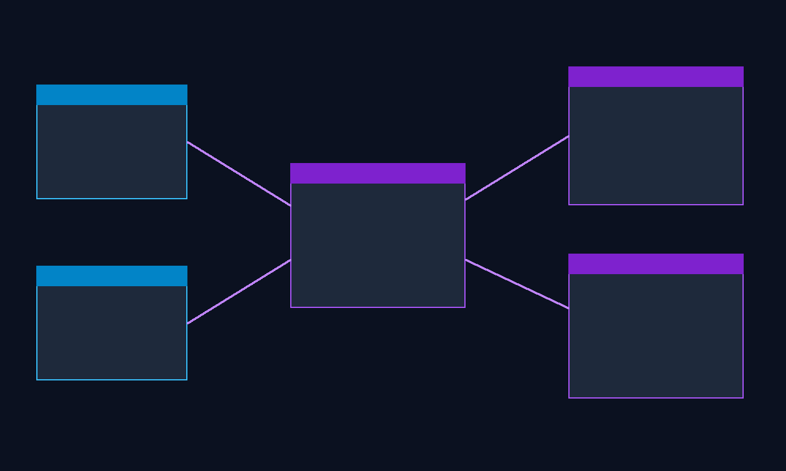
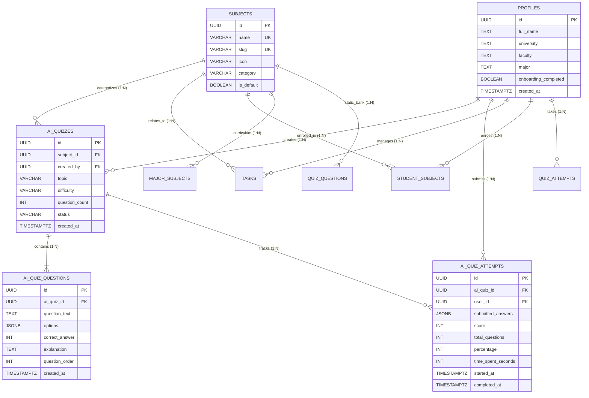

# AI Quiz Entity Relationship Diagram (ERD)

**Project:** Smart Study Companion  
**Team:** Team 5 — Capstone Design, Fall 2026 (Ulsan College)  
**Schema Level:** PostgreSQL Normalized Relational Model with Row Level Security  

---

## 1. Complete Entity Relationship Diagram

---

## 2. Explanation of Relational Cardinalities

### 1. `profiles` $\rightarrow$ `ai_quizzes` (One-to-Many: 1 : N)
- **Foreign Key:** `ai_quizzes.created_by` $\rightarrow$ `profiles.id` (ON DELETE CASCADE)
- **Semantics:** Each student profile can generate multiple topic-specific AI quizzes over time. Deleting a profile automatically removes all their generated AI quizzes.
- **Security Rule:** RLS allows students to read and query only quizzes where `created_by = auth.uid()`.

### 2. `subjects` $\rightarrow$ `ai_quizzes` (One-to-Many: 1 : N)
- **Foreign Key:** `ai_quizzes.subject_id` $\rightarrow$ `subjects.id` (ON DELETE CASCADE)
- **Semantics:** Every AI quiz is grounded in an accredited university course (e.g. *Operating Systems*, *Fluid Mechanics*, *Marketing Management*).

### 3. `ai_quizzes` $\rightarrow$ `ai_quiz_questions` (One-to-Many: 1 : N)
- **Foreign Key:** `ai_quiz_questions.ai_quiz_id` $\rightarrow$ `ai_quizzes.id` (ON DELETE CASCADE)
- **Semantics:** A quiz session contains between 5 and 20 individual structured multiple-choice questions.
- **Integrity Rule:** `ai_quiz_questions.options` stores a JSONB array of exactly 4 choices. `correct_answer` is constrained between `0` and `3`.

### 4. `ai_quizzes` $\rightarrow$ `ai_quiz_attempts` (One-to-Many: 1 : N)
- **Foreign Key:** `ai_quiz_attempts.ai_quiz_id` $\rightarrow$ `ai_quizzes.id` (ON DELETE CASCADE)
- **Semantics:** A generated quiz can be attempted and retaken by students. Each attempt records submission timestamps, scores, and full answer histories.

### 5. `profiles` $\rightarrow$ `ai_quiz_attempts` (One-to-Many: 1 : N)
- **Foreign Key:** `ai_quiz_attempts.user_id` $\rightarrow$ `profiles.id` (ON DELETE CASCADE)
- **Semantics:** Direct student ownership of attempt records, powering personal study history and analytics views.

---

## 3. Schema Evolution: Core vs. Extension

| Schema Aspect | Core Database Schema (Migrations 001–008) | AI Quiz Extension (Migration 009) |
|---|---|---|
| **Question Storage** | `public.quiz_questions` (Static, 345 verified faculty questions) | `public.ai_quiz_questions` (Dynamic, prompt-tailored) |
| **Quiz Attempts** | `public.quiz_attempts` (Standard 15 Qs, Rapid 10 Qs / 30s) | `public.ai_quiz_attempts` (Custom count, topic metadata, explanations) |
| **Academic Catalog** | 46 universities, 32 subjects, 128 major curricula | Reuses existing subject and profile IDs without duplication |
| **Separation of Concerns** | Faculty-approved core test bank | AI questions kept strictly segregated to prevent unverified mixing |
