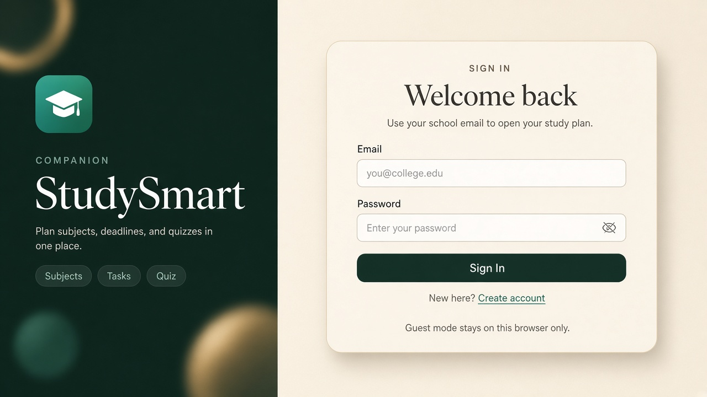
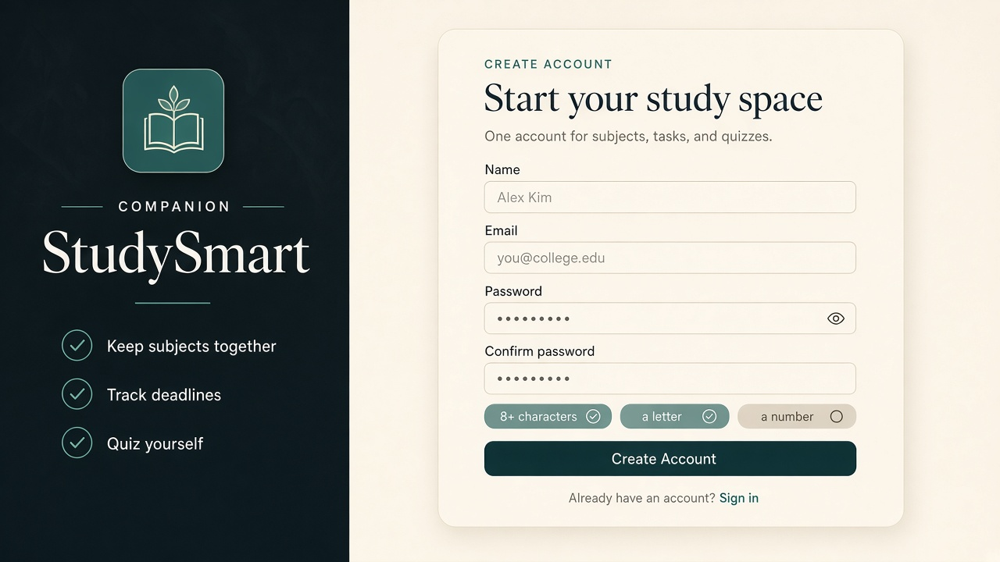
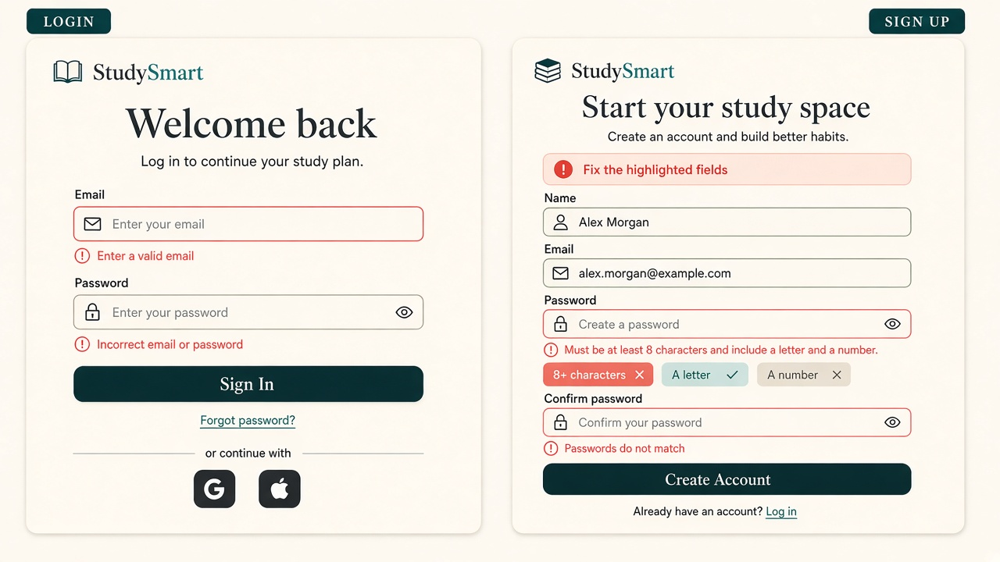
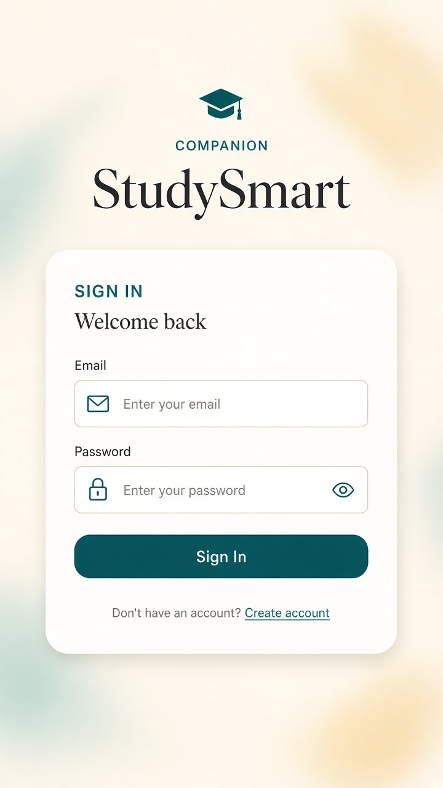

# Week 9 — Login and Signup UI design

**Project:** Smart Study Companion  
**Date:** 2026-10-28 (UI proposal); analysis updated 2026-11-03  
**Status:** UI proposal (clickable mockups), reviewed alongside Week 9 implementation and test records  
**Backend auth:** The mockups in `Frontend/auth/` are standalone UI demonstrations and do not authenticate users. The current application is documented as using Supabase Auth and PostgreSQL; see the [Week 9 team report](weekly-report.md) and [database-model review](database-model-check-report.md). The Week 5 no-auth decision is historical context, not a description of the current implementation.

---

## Week 9 document analysis

This page describes the design intent and behavior of the standalone login/signup mockups. It should not be read as evidence that the whole application has no authentication or that these mockup pages are the production auth flow.

### Findings across this week's records

- **Architecture changed:** Week 5 records the original localStorage/no-auth MVP decision. Week 9 records a Supabase Auth/PostgreSQL implementation. Treat the Week 5 decision and older Week 8 proposals as historical; use the current code, migrations, and Week 9 reports for present-state descriptions.
- **Separate the two auth artifacts:** `Frontend/auth/login.html` and `signup.html` are clickable design mockups that perform client-side validation only. The application auth pages are documented under `public/auth/` and use the Supabase-backed implementation. A successful mockup submission is not evidence of account creation or a live auth flow.
- **Testing evidence has limits:** The Week 9 test report records passing unit/static checks and a production build on a modified local working snapshot. Its fresh browser smoke test was not run, and no live Supabase credentials were used. Therefore, live signup, email verification, RLS, cloud persistence, and two-account isolation remain unverified by that report.
- **Follow-up issues are open:** The database review and upgrade plan note course-catalog/task persistence and quiz-question/answer recording concerns; the review also flags client visibility of quiz answer keys. These are findings to verify and address, not completed fixes.
- **Setup documentation needs alignment:** The upgrade plan says migration `007_universities.sql` is present while setup instructions list migrations 001–006. Confirm the full ordered migration set on a clean Supabase project before claiming setup is complete.

For details and evidence, see the [Week 9 team report](weekly-report.md), [test report](TEST_REPORT_2026-11-03.md), [database-model review](database-model-check-report.md), and [next-week upgrade plan](NEXT_WEEK_UPGRADE_PLAN.md). The records distinguish implementation review, automated checks, local preview, browser testing, and live Supabase testing; do not treat them as interchangeable evidence.

---

## What this delivers

| Screen | Required controls | Clickable mockup |
|---|---|---|
| Login | Email, password, **Sign In**, **Create Account** link | [Frontend/auth/login.html](../../Frontend/auth/login.html) |
| Signup | Name, email, password, confirm password, **Create Account** | [Frontend/auth/signup.html](../../Frontend/auth/signup.html) |

Open the HTML files in a browser. Validation runs in the page only. Successful Sign In / Create Account does **not** create a real user.

---

## Visual direction

The screens reuse the live prototype language from `Frontend/styles.css`:

- Cream canvas `#f3eee4`, ink `#1c1915`, teal `#0f766e`, coral for errors `#c2410c`
- Dark brand rail `#17211f` (same as the app sidebar)
- Fraunces headings, Outfit body
- Frosted card, 22px radius, pill primary button

**Layout:** split screen. Brand story on the left, form card on the right. Under 860px the brand rail stacks on top and the form stays full width.

Do not add Google / GitHub buttons on these screens. OAuth is a later option in [Authentication_Techinical_Decision.md](../week5/Authentication_Techinical_Decision.md), not part of this UI.

---

## Image references (mockups)

Generated visual references for review. Treat the HTML pages as the source of truth for labels and validation; the images show intended look.

### Login (desktop)



### Signup (desktop)



### Error and password-rule states



### Login (mobile)



Files:

- [`mockups/login-desktop.jpg`](mockups/login-desktop.jpg)
- [`mockups/signup-desktop.jpg`](mockups/signup-desktop.jpg)
- [`mockups/auth-error-states.jpg`](mockups/auth-error-states.jpg)
- [`mockups/auth-mobile.jpg`](mockups/auth-mobile.jpg)

---

## Field map

### Login

| Field | Type | Autocomplete | Notes |
|---|---|---|---|
| Email | `email` | `username` | Required, must look like an email |
| Password | `password` | `current-password` | Required; show/hide toggle |
| Sign In | submit | — | Always enabled; errors appear on submit |
| Create account | link → signup.html | — | Secondary action, not a second button |

### Signup

| Field | Type | Autocomplete | Notes |
|---|---|---|---|
| Name | `text` | `name` | Required, at least 2 characters |
| Email | `email` | `email` | Required, valid format |
| Password | `password` | `new-password` | See rules below; live rule pills |
| Confirm password | `password` | `new-password` | Must match password |
| Create Account | submit | — | Always enabled; errors appear on submit |
| Sign in | link → login.html | — | For existing users |

---

## Password requirements

Shown as three pills under the password field on signup. Pills turn teal when met, coral when the user has typed something that still fails.

| Rule | Check |
|---|---|
| 8+ characters | `length >= 8` |
| A letter | `/[A-Za-z]/` |
| A number | `/\d/` |

Confirm password is a separate check: values must be identical.

These rules are meant for a student planner, not a bank. If the team later adds a server, the same rules should be enforced on the server, not only in the browser.

---

## Error copy (use these strings)

Keep messages short, field-specific, and free of blame.

| Situation | Message |
|---|---|
| Empty or invalid email | Enter a valid email. |
| Empty login password | Enter your password. |
| Wrong login combination (when a backend exists) | Incorrect email or password. |
| Name too short | Enter your name (at least 2 characters). |
| Weak password | Must be at least 8 characters and include a letter and a number. |
| Confirm mismatch | Passwords do not match. |
| Any submit with errors | Fix the highlighted fields. (banner at top of card) |

Login should not say which of email or password is wrong once a real backend exists. The mockup still checks format locally so empty fields are obvious.

---

## Usability rules

1. **Labels stay visible.** Placeholder is an example (`you@college.edu`), not the only label.
2. **Show / hide password** on password and confirm fields.
3. **Do not disable the primary button.** Disabled submit hides the reason the form will not go. Validate on submit and mark `aria-invalid`.
4. **Errors sit under the field** and are wired with `aria-describedby`. The banner is `role="alert"`.
5. **`novalidate`** on the form so the custom copy is shown instead of the browser bubble.
6. **One primary action** per page. Create Account on login is a text link.
7. **Keyboard:** tab order is fields → show/hide → submit → opposite-page link. Focus ring uses teal.
8. **Reduced motion:** hover lift is turned off when `prefers-reduced-motion` is set.
9. **Guest note:** the login brand copy states that guest data stays in the current browser, matching the Week 5 localStorage model until accounts exist.

---

## Owner validation check (J.N. Taj Oli)

The current design should be reviewed with these checks before claiming it matches the intended validation behavior:

- Submit the login form empty: the email field should show `Enter a valid email.` and the password field should show `Enter your password.`.
- On signup, test an invalid email, a short name, a weak password, and a mismatched confirm password. Each problem should show a short, field-specific error and the alert banner at the top of the card.
- While typing in the password field, the three rule pills should turn teal when satisfied and coral when the user has entered text that still fails the rule.
- Confirm that the error text is visible near the correct field, not only in a generic alert, and that the input states reflect `aria-invalid` properly.

---

## Suggested flow (when auth is assigned)

```
Open app
  → Login
      → Sign In (valid) → existing dashboard (Frontend/index.html)
      → Create account → Signup
          → Create Account (valid) → Login
          → Sign in → Login
```

The HTML mockup follows this path. It does not save accounts.

---

## Out of scope for this owner

- Password hashing, sessions, JWT, or any API
- Email verification or password reset
- OAuth
- Replacing the MVP “no login” decision

If the team later assigns backend auth, implement the field names and error codes above so the UI does not have to change.

---

## How to review

1. Open [Frontend/auth/login.html](../../Frontend/auth/login.html).
2. Submit empty fields; confirm coral messages.
3. Follow **Create account**, try a short password and a mismatched confirm.
4. Watch the three requirement pills update while typing.
5. Compare the page to the images in `mockups/`.

## Owner: J.N. Taj Oli
