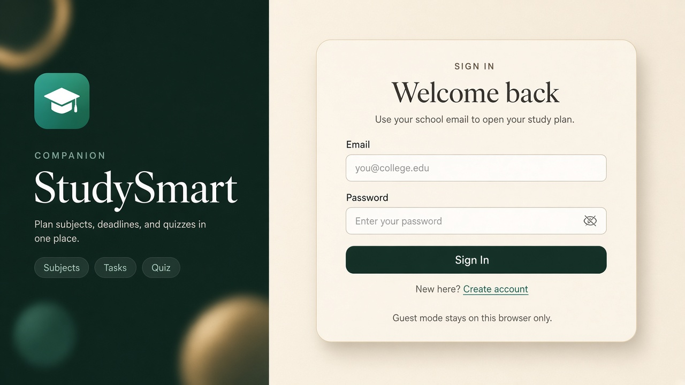
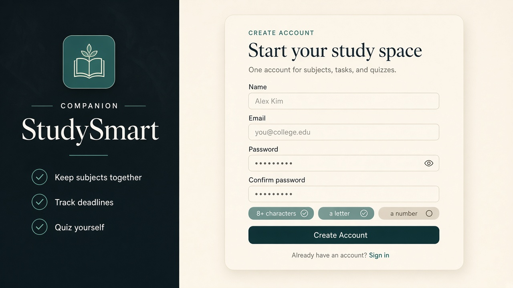
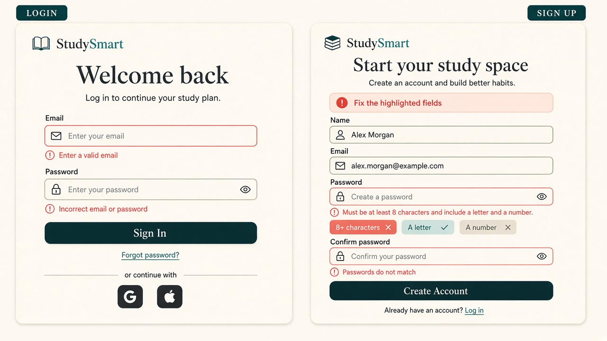
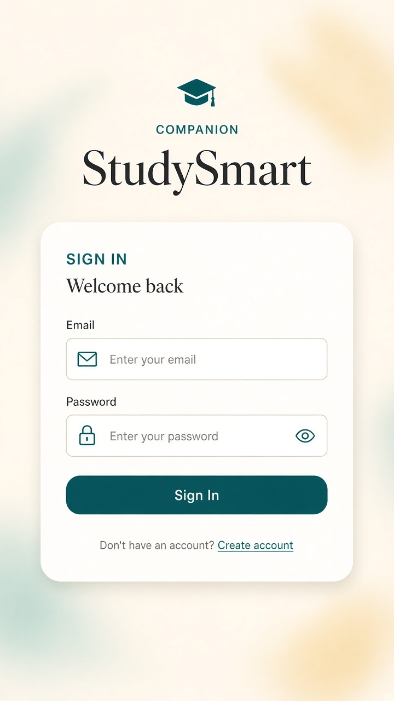

# Week 9 — Login and Signup UI design

**Project:** Smart Study Companion  
**Date:** 2026-10-28  
**Status:** UI proposal (clickable mockups)  
**Backend auth:** Not included. Week 5 still records no authentication for the MVP. This work is the screen design the team asked for before Week 9.

---

## What this delivers

| Screen | Required controls | Clickable mockup |
|---|---|---|
| Login | Email, password, **Sign In**, **Create Account** link | [Frontend/auth/login.html](../../Frontend/auth/login.html) |
| Signup | Name, email, password, confirm password, **Create Account** | [Frontend/auth/signup.html](../../Frontend/auth/signup.html) |

Open the HTML files in a browser. Validation runs in the page only. Successful Sign In / Create Account does **not** create a real user.

---

## Visual direction

The screens reuse the live prototype language from `Frontend/styles.css`:

- Cream canvas `#f3eee4`, ink `#1c1915`, teal `#0f766e`, coral for errors `#c2410c`
- Dark brand rail `#17211f` (same as the app sidebar)
- Fraunces headings, Outfit body
- Frosted card, 22px radius, pill primary button

**Layout:** split screen. Brand story on the left, form card on the right. Under 860px the brand rail stacks on top and the form stays full width.

Do not add Google / GitHub buttons on these screens. OAuth is a later option in [Authentication_Techinical_Decision.md](../week5/Authentication_Techinical_Decision.md), not part of this UI.

---

## Image references (mockups)

Generated visual references for review. Treat the HTML pages as the source of truth for labels and validation; the images show intended look.

### Login (desktop)



### Signup (desktop)



### Error and password-rule states



### Login (mobile)



Files:

- [`mockups/login-desktop.jpg`](mockups/login-desktop.jpg)
- [`mockups/signup-desktop.jpg`](mockups/signup-desktop.jpg)
- [`mockups/auth-error-states.jpg`](mockups/auth-error-states.jpg)
- [`mockups/auth-mobile.jpg`](mockups/auth-mobile.jpg)

---

## Field map

### Login

| Field | Type | Autocomplete | Notes |
|---|---|---|---|
| Email | `email` | `username` | Required, must look like an email |
| Password | `password` | `current-password` | Required; show/hide toggle |
| Sign In | submit | — | Always enabled; errors appear on submit |
| Create account | link → signup.html | — | Secondary action, not a second button |

### Signup

| Field | Type | Autocomplete | Notes |
|---|---|---|---|
| Name | `text` | `name` | Required, at least 2 characters |
| Email | `email` | `email` | Required, valid format |
| Password | `password` | `new-password` | See rules below; live rule pills |
| Confirm password | `password` | `new-password` | Must match password |
| Create Account | submit | — | Always enabled; errors appear on submit |
| Sign in | link → login.html | — | For existing users |

---

## Password requirements

Shown as three pills under the password field on signup. Pills turn teal when met, coral when the user has typed something that still fails.

| Rule | Check |
|---|---|
| 8+ characters | `length >= 8` |
| A letter | `/[A-Za-z]/` |
| A number | `/\d/` |

Confirm password is a separate check: values must be identical.

These rules are meant for a student planner, not a bank. If the team later adds a server, the same rules should be enforced on the server, not only in the browser.

---

## Error copy (use these strings)

Keep messages short, field-specific, and free of blame.

| Situation | Message |
|---|---|
| Empty or invalid email | Enter a valid email. |
| Empty login password | Enter your password. |
| Wrong login combination (when a backend exists) | Incorrect email or password. |
| Name too short | Enter your name (at least 2 characters). |
| Weak password | Must be at least 8 characters and include a letter and a number. |
| Confirm mismatch | Passwords do not match. |
| Any submit with errors | Fix the highlighted fields. (banner at top of card) |

Login should not say which of email or password is wrong once a real backend exists. The mockup still checks format locally so empty fields are obvious.

---

## Usability rules

1. **Labels stay visible.** Placeholder is an example (`you@college.edu`), not the only label.
2. **Show / hide password** on password and confirm fields.
3. **Do not disable the primary button.** Disabled submit hides the reason the form will not go. Validate on submit and mark `aria-invalid`.
4. **Errors sit under the field** and are wired with `aria-describedby`. The banner is `role="alert"`.
5. **`novalidate`** on the form so the custom copy is shown instead of the browser bubble.
6. **One primary action** per page. Create Account on login is a text link.
7. **Keyboard:** tab order is fields → show/hide → submit → opposite-page link. Focus ring uses teal.
8. **Reduced motion:** hover lift is turned off when `prefers-reduced-motion` is set.
9. **Guest note:** the login brand copy states that guest data stays in the current browser, matching the Week 5 localStorage model until accounts exist.

---

## Suggested flow (when auth is assigned)

```
Open app
  → Login
      → Sign In (valid) → existing dashboard (Frontend/index.html)
      → Create account → Signup
          → Create Account (valid) → Login
          → Sign in → Login
```

The HTML mockup follows this path. It does not save accounts.

---

## Out of scope for this owner

- Password hashing, sessions, JWT, or any API
- Email verification or password reset
- OAuth
- Replacing the MVP “no login” decision

If the team later assigns backend auth, implement the field names and error codes above so the UI does not have to change.

---

## How to review

1. Open [Frontend/auth/login.html](../../Frontend/auth/login.html).
2. Submit empty fields; confirm coral messages.
3. Follow **Create account**, try a short password and a mismatched confirm.
4. Watch the three requirement pills update while typing.
5. Compare the page to the images in `mockups/`.
   ## Owner: Jn Taj oli
