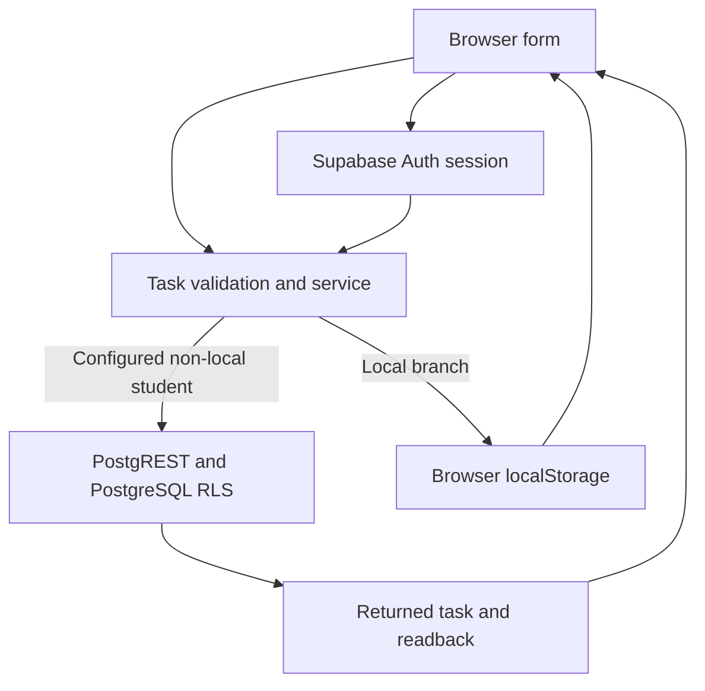
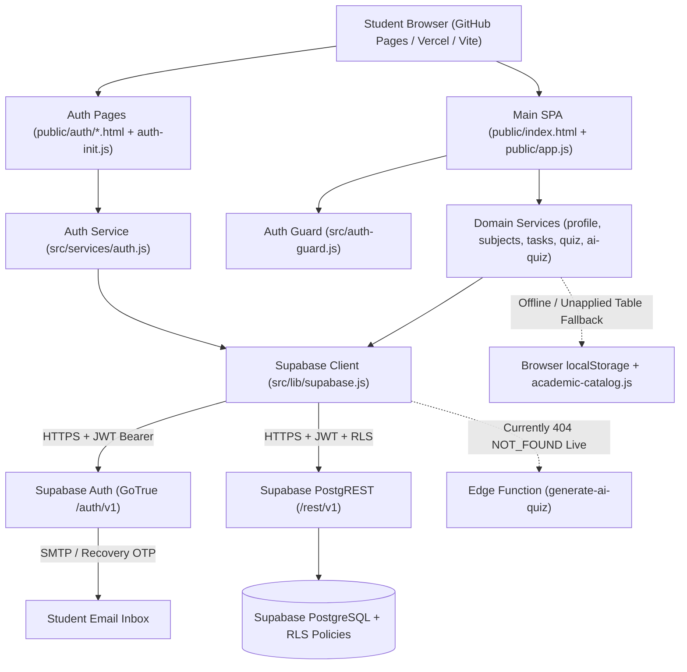

# Backend Architecture — Week 10 Audit

## Week 11 current task boundary

Static inspection on 2026-11-14 at `c8f90a16414b3d93cb19e34733b29b6b2856f435`; no new live execution. The original audit below remains historical, including its dated runtime findings.

Trace: [task service](../../public/src/services/tasks.js) trims titles, requires 1-500 characters and validates a supplied deadline. It accepts camel/snake student/subject aliases. The configured non-local student branch validates the subject UUID, inserts task fields, selects the returned row and reads with a student filter. The local branch uses `smart_study_tasks`; its read path does not establish per-user isolation. Display/reload must still be checked in the deployed application.

The [client](../../public/src/lib/supabase.js) has environment/window configuration and default public configuration fallback. Missing `.env` alone does not establish Local Preview Mode. Confirm actual runtime routing and sanitized service responses. Never publish configuration values or session tokens in receipts.

Intended boundaries are not verified outcomes: [matrix](../week_11/MVP_VERIFICATION_MATRIX.md). Older field-mismatch findings need reproduction against the current deployed revision because alias handling now exists. Historical AI storage/content, recovery and answer-key visibility limitations remain tracked in the [risk register](../week_11/DEFECT_AND_RISK_REGISTER.md); no fix is inferred from this diagram.

## Historical Week 10 audit

**Project:** Smart Study Companion — Team 5  
**Directory Scope:** [`docs/week_10/`](weekly-report.md) (consolidated into the repository's existing Week 10 folder rather than creating a duplicate `docs/Week10/` directory)  
**Companion Architecture Docs:** [`docs/COMPLETE_BACKEND_INTEGRATION_REPORT.md`](../COMPLETE_BACKEND_INTEGRATION_REPORT.md), [`docs/week_10/FULL_STACK_CHANGES_MODEL.md`](FULL_STACK_CHANGES_MODEL.md)

---

## 1. Project Overview

Smart Study Companion is a university study management web application enabling students to onboard with their country, university, faculty, major, and enrolled subjects, manage study tasks and deadlines, view study analytics, and practice Standard (`15` questions), Rapid (`10` questions / `30s`), and topic-tailored AI quizzes backed by Supabase Authentication and Supabase PostgreSQL.

---

## 2. Actual Technology Stack

| Layer | Technology / Source | Observed Version / Details |
|---|---|---|
| Frontend UI | Vanilla HTML5, CSS3, ES Modules | `public/index.html`, `public/styles.css`, `public/app.js`, `public/auth/*.html` |
| Bundler / Dev Server | Vite | `^6.0.0` (`vite.config.js` builds 6 multi-page HTML entries from `public/` to `dist/`) |
| Backend Client SDK | `@supabase/supabase-js` | `^2.45.0` in `package.json`; loaded via `https://esm.sh/@supabase/supabase-js@2.45.0` in `src/lib/supabase.js` |
| Authentication | Supabase Auth (GoTrue REST) | Email/password signup, login, OTP/link recovery, session refresh (`detectSessionInUrl: true`) |
| Database | Supabase PostgreSQL 15+ + PostgREST | Normalized tables + Row Level Security (`supabase/migrations/001`–`010` + `supabase/setup_all.sql`) |
| Serverless Edge Runtime | Supabase Edge Functions (Deno) | `supabase/functions/generate-ai-quiz/index.ts` *(currently returns `404 NOT_FOUND` on live cloud)* |
| Static Hosting | GitHub Pages / Vercel | `vercel.json` headers & rewrites; `/public/` deployed on GitHub Pages; root `index.html` redirects to `public/index.html` |
| Testing | Python 3 + Vitest (`^2.1.0`) | `tests/run_tests.py`, `tests/test_ai_quiz.py`, `tests/unit/*.test.js` (`tests/e2e/` is currently empty) |

---

## 3. Frontend Structure

- Root entry redirect: [`index.html`](../../index.html) forwards query/hash parameters immediately to [`public/index.html`](../../public/index.html).
- Main SPA shell: [`public/index.html`](../../public/index.html) contains 5 views (`#view-dashboard`, `#view-tasks`, `#view-subjects`, `#view-analytics`, `#view-quiz`) plus `#task-modal`, `#confirm-modal`, and quiz history panels (`#quiz-history-panel`, `#analytics-quiz-summary`).
- Core controller: [`public/app.js`](../../public/app.js) (mirrored byte-for-byte with root [`app.js`](../../app.js)) coordinates session loading, catalog preloading, task CRUD, analytics computation, academic hierarchy cascading selectors, and quiz state.
- Authentication pages: [`public/auth/login.html`](../../public/auth/login.html), [`public/auth/signup.html`](../../public/auth/signup.html), [`public/auth/verify.html`](../../public/auth/verify.html), [`public/auth/forgot-password.html`](../../public/auth/forgot-password.html), and [`public/auth/reset-password.html`](../../public/auth/reset-password.html), all driven by [`public/auth/auth-init.js`](../../public/auth/auth-init.js).
- Client session guard: [`src/auth-guard.js`](../../src/auth-guard.js) (mirrored in [`public/src/auth-guard.js`](../../public/src/auth-guard.js)).
- Theme state: [`src/theme.js`](../../src/theme.js) / [`public/src/theme.js`](../../public/src/theme.js).

---

## 4. Backend Services

All service modules live in [`src/`](../../src/) and are synchronized byte-for-byte into [`public/src/`](../../public/src/):

| Service File | Exports | Target Supabase Resources |
|---|---|---|
| [`src/services/auth.js`](../../src/services/auth.js) | `signUp`, `signIn`, `signOut`, `resetPassword`, `verifyOtp`, `resendPasswordReset`, `updatePassword`, `resendVerification`, `getCurrentUser`, `getSession`, `onAuthStateChange` | Supabase Auth (`/auth/v1/*`) |
| [`src/services/profile.js`](../../src/services/profile.js) | `getProfile`, `upsertProfile`, `updateDisplayName` | `public.profiles` |
| [`src/services/subjects.js`](../../src/services/subjects.js) | `getUniversitiesCatalog`, `getDefaultSubjects`, `getAllSubjects`, `getSubjectsByMajor`, `getStudentSubjects`, `saveStudentSubjects`, `enrollInSubject` | `public.universities`, `public.subjects`, `public.major_subjects`, `public.student_subjects` |
| [`src/services/tasks.js`](../../src/services/tasks.js) | `getTasks`, `getTasksBySubject`, `createTask`, `updateTask`, `toggleTask`, `deleteTask` | `public.tasks` |
| [`src/services/quiz.js`](../../src/services/quiz.js) | `getQuizQuestions`, `saveQuizAttempt`, `getQuizHistory` | `public.quiz_questions`, `public.quiz_attempts`, `public.quiz_responses`, `public.subjects` |
| [`src/services/ai-quiz.js`](../../src/services/ai-quiz.js) | `isValidQuestion`, `validateAndSanitizeQuestions`, `generateAiQuiz`, `saveAiQuizAttempt`, `getAiQuizHistory` | Edge Function `generate-ai-quiz`; tables `public.ai_quizzes`, `public.ai_quiz_questions`, `public.ai_quiz_attempts` (`404 PGRST205` currently on live DB) |
| [`supabase/functions/generate-ai-quiz/index.ts`](../../supabase/functions/generate-ai-quiz/index.ts) | Deno HTTP handler | Authenticated Edge Function *(not deployed live yet; returns `404 NOT_FOUND`)* |

---

## 5. Supabase Auth Integration

- `supabase.auth.signUp()` creates the user and immediately invokes `supabase.auth.signOut()` inside `signUp()` if Supabase returned an auto-session (which happens while live `"mailer_autoconfirm": true` is enabled), forcing explicit student sign-in on `login.html?registered=true`.
- `supabase.auth.signInWithPassword()` creates the JWT session (`persistSession: true`, `autoRefreshToken: true`).
- `supabase.auth.resetPasswordForEmail()` sends recovery instructions redirecting to `${getAuthBaseUrl()}/auth/reset-password.html`.
- `supabase.auth.verifyOtp({ email, token, type: 'recovery' | 'signup' | 'email' })` verifies 6-digit PINs after stripping non-digit characters.
- `supabase.auth.updateUser({ password })` updates the password for a verified recovery session and signs out so the student logs in fresh.
- Live probe (`GET /auth/v1/settings`, 2026-11-10) returned HTTP `200`: `external.email: true`, `disable_signup: false`, `mailer_autoconfirm: true`.

---

## 6. Supabase PostgreSQL Integration

- Database URL: `https://bcwwnjtmrcxggbaallon.supabase.co`
- Live PostgREST catalog checks (2026-11-10):
  - `universities`: `46` rows
  - `subjects`: `32` rows
  - `major_subjects`: `128` rows
  - `quiz_questions`: `345` rows
- Private student tables live (`profiles`, `student_subjects`, `tasks`, `quiz_attempts`, `quiz_responses`) return HTTP `200` with `[]` for anonymous `apikey` requests due to RLS.
- Migration `009` AI tables (`ai_quizzes`, `ai_quiz_questions`, `ai_quiz_attempts`) are missing on live Supabase Cloud (`404 PGRST205`).
- Migration `010` ([`010_complete_universities.sql`](../../supabase/migrations/010_complete_universities.sql)) was created in the codebase to add `Bhutan`, `Maldives`, `Other / International`, and extra regional entries, and is pending execution in live SQL Editor.

---

## 7. Database Relationships

- `auth.users(id)` `1:1` → `public.profiles(id)` via `handle_new_user()` trigger (`ON DELETE CASCADE`).
- `public.profiles(id)` `1:N` → `student_subjects`, `tasks`, `quiz_attempts`, `ai_quizzes` (`created_by`), `ai_quiz_attempts` (`user_id`).
- `public.subjects(id)` `1:N` → `student_subjects`, `tasks`, `quiz_questions`, `quiz_attempts`, `ai_quizzes`.
- `public.subjects(slug)` `1:N` → `public.major_subjects(subject_slug)`.
- `public.quiz_attempts(id)` `1:N` → `public.quiz_responses(attempt_id)` referencing `quiz_questions(id)`.
- `public.ai_quizzes(id)` `1:N` → `ai_quiz_questions(ai_quiz_id)` and `ai_quiz_attempts(ai_quiz_id)`.

*(See [`database-verification.md`](database-verification.md) for the complete Mermaid ERD.)*

---

## 8. API Requests and Data Flow

1. Browser loads [`public/index.html`](../../public/index.html) → runs [`loadUserData()`](../../public/app.js).
2. `getSession()` verifies active JWT or redirects to `auth/login.html`.
3. `getProfile(currentUser.id)` retrieves `country`, `university`, `faculty`, `major`, `onboarding_completed`.
4. `Promise.all([getAllSubjects(), getUniversitiesCatalog()])` preloads UUID catalogs before calling `getStudentSubjects(currentUser.id)`, `getTasks(currentUser.id)`, and `loadAndRenderQuizHistory()`.
5. Mutations (`createTask`, `updateTask`, `toggleTask`, `deleteTask`, `saveStudentSubjects`, `upsertProfile`, `saveQuizAttempt`, `saveAiQuizAttempt`) send authenticated PostgREST calls with user bearer tokens; RLS validates `auth.uid()` on every row.

---

## 9. Environment Variable Requirements

From [`.env.example`](../../.env.example) and [`src/lib/supabase.js`](../../src/lib/supabase.js):

- `VITE_SUPABASE_URL` / `NEXT_PUBLIC_SUPABASE_URL`: Public Supabase project API URL (`https://bcwwnjtmrcxggbaallon.supabase.co`).
- `VITE_SUPABASE_ANON_KEY` / `NEXT_PUBLIC_SUPABASE_PUBLISHABLE_KEY`: Public Supabase anon/publishable client key (`sb_publishable_...`).
- **Strictly Forbidden in Client Code:** `SUPABASE_SERVICE_ROLE_KEY`, SMTP passwords, and future `GEMINI_API_KEY` (must live exclusively in Supabase Edge Function Secrets).

---

## 10. Backend Security Architecture

- Row Level Security (`ALTER TABLE ... ENABLE ROW LEVEL SECURITY`) defined across all tables in [`006_rls_policies.sql`](../../supabase/migrations/006_rls_policies.sql), [`007_universities.sql`](../../supabase/migrations/007_universities.sql), [`008_major_subjects_quiz_bank.sql`](../../supabase/migrations/008_major_subjects_quiz_bank.sql), and [`009_ai_quiz_tables.sql`](../../supabase/migrations/009_ai_quiz_tables.sql).
- Security headers in [`vercel.json`](../../vercel.json): `X-Frame-Options: DENY`, `X-Content-Type-Options: nosniff`, `Referrer-Policy: strict-origin-when-cross-origin`.
- HTML escaping (`escapeHtml()`) applied across rendered task, deadline, subject, analytics, and quiz elements in [`public/app.js`](../../public/app.js).
- Client-side validation backed by PostgreSQL `CHECK` constraints (`tasks.title` 1–500 chars, `quiz_attempts.mode IN ('standard', 'rapid')`, `ai_quizzes.difficulty IN ('easy', 'medium', 'hard')`).

---

## 11. Architecture Diagram

---

## 12. Identified Architecture Problems

1. **Public Default Key Embedded for Static Hosting (`src/lib/supabase.js`):** Hardcodes public URL + publishable key as fallback for GitHub Pages static serving (safe only because publishable key is public and RLS must protect private tables, though live RLS write enforcement still requires interactive two-student testing).
2. **Client-Side Quiz Scoring & Answer Visibility:** `quiz_questions.correct_answer` is queried to the browser in `getQuizQuestions()`, allowing inspection in network devtools before submission.
3. **Migration Drift on Live Cloud:** Live DB has `001`–`008` applied, while `009_ai_quiz_tables.sql` (`404 PGRST205`) and `010_complete_universities.sql` remain unapplied in Supabase SQL Editor.
4. **Edge Function Not Deployed:** `generate-ai-quiz` returns `404 NOT_FOUND` on live Supabase Cloud.
5. **Dual Code Mirror Maintenance:** Both root (`app.js`, `src/`) and `public/` (`public/app.js`, `public/src/`) must remain manually synced (`diff` verified zero divergence as of commit `ec6bd38`).
6. **External SMTP & Confirm-Email Disabled Live:** `/auth/v1/settings` reports `"mailer_autoconfirm": true`, skipping signup confirmation emails and leaving password recovery dependent on rate-limited built-in SMTP.

---

## 13. Recommended Improvements

1. Execute `009_ai_quiz_tables.sql` and `010_complete_universities.sql` in Supabase SQL Editor.
2. Deploy `supabase/functions/generate-ai-quiz/index.ts` and configure Custom SMTP + `Confirm email` + `{{ .Token }}` email templates in Supabase Dashboard.
3. Move curated/AI quiz grading into a Postgres RPC or Edge Function so `correct_answer` is hidden prior to attempt submission.
4. Populate Playwright E2E specs under `tests/e2e/` against disposable test accounts to verify live two-student RLS isolation automatically.
5. Long term, eliminate manual file mirroring by serving Vite `dist/` directly in deployment workflows.
