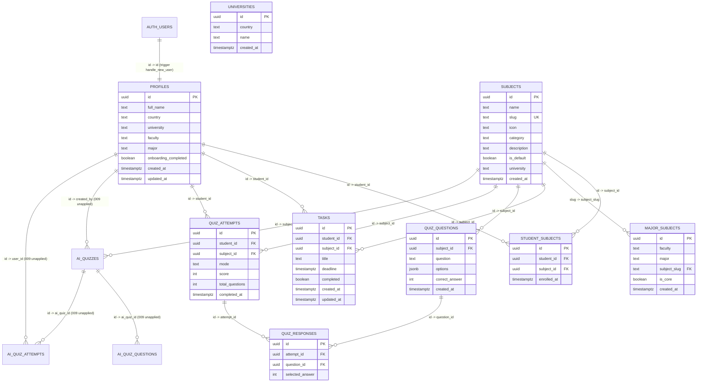

# Database Verification — Week 10 Audit

**Project:** Smart Study Companion — Team 5  
**Companion Report:** [`SUPABASE_VERIFICATION_REPORT.md`](SUPABASE_VERIFICATION_REPORT.md) (Sumit Adhikari's static baseline audit)  
**Target Instance:** `https://bcwwnjtmrcxggbaallon.supabase.co`  

---

## 1. Existing Database Tables (Inspected Live & in SQL Migrations)

Derived directly from [`supabase/migrations/001`–`010`](../../supabase/migrations/) and verified against live PostgREST endpoints on 2026-11-10:

1. **Live Production Tables (`001`–`008` applied):**
   - `profiles` (`001_profiles.sql` + `007_universities.sql`)
   - `universities` (`007_universities.sql`; `010_complete_universities.sql` pending execution)
   - `subjects` (`002_subjects.sql` + `007` + `008`)
   - `major_subjects` (`008_major_subjects_quiz_bank.sql`)
   - `student_subjects` (`002_subjects.sql`)
   - `tasks` (`003_tasks.sql`)
   - `quiz_questions` (`004_quiz_questions.sql` + `008`)
   - `quiz_attempts` (`005_quiz_attempts.sql`)
   - `quiz_responses` (`005_quiz_attempts.sql`)
2. **Migration Defined in Code but Missing Live (`404 PGRST205`):**
   - `ai_quizzes`, `ai_quiz_questions`, `ai_quiz_attempts` (`009_ai_quiz_tables.sql`)

---

## 2. Entity-Relationship Diagram & Foreign Keys

---

## 3. Supabase Connection Status

- Live project REST & Auth endpoints reachable via HTTPS with public publishable key (`sb_publishable_w2FL6KB5yEyy_iatIN993Q_ifuBdl7i`).
- Read-only PostgREST verification succeeded (`HTTP 200`/`206`) across `001`–`008` tables; Migration `009` returned `404 PGRST205`.

---

## 4. Student Profile Persistence

- `profiles` stores `full_name`, `country`, `university`, `faculty`, `major`, and `onboarding_completed`, initialized via `public.handle_new_user()` trigger (`007_universities.sql`) and updated via [`upsertProfile`](../../src/services/profile.js).
- Live table exists (`HTTP 200`, `[]` unauthenticated); authenticated interactive round-trip read/write is **NOT TESTED**.

---

## 5. Countries and Universities

- Live `public.universities` contains **`46` rows** across `7` countries (`Bangladesh`, `India`, `Nepal`, `Pakistan`, `South Asia`, `South Korea`, `Sri Lanka`).
- [`010_complete_universities.sql`](../../supabase/migrations/010_complete_universities.sql) adds `Bhutan`, `Maldives`, `Other / International`, and missing institutions (to match all `10` countries in [`academic-catalog.js`](../../src/lib/academic-catalog.js)) — **pending execution in SQL Editor**.

---

## 6. Faculties and Departments (`major_subjects`)

- Live `public.major_subjects` contains **`128` rows** (`HTTP 206`) mapping `faculty`, `major`, `subject_slug`, and `is_core` across `4` faculties and `15` majors.

---

## 7. Subjects (`subjects` & `student_subjects`)

- Live `public.subjects` contains **`32` rows** (`HTTP 206`), strictly read-only for clients via policy `subjects_select_all`.
- Fixed [`subjects.js`](../../src/services/subjects.js) so client enrollments only read `subjects` and write to `student_subjects` (where `006_rls_policies.sql` grants `SELECT`, `INSERT`, `UPDATE`, `DELETE` for `auth.uid() = student_id`).

---

## 8. Tasks and Deadlines (`tasks`)

- Schema (`003_tasks.sql`) enforces `CHECK (char_length(title) >= 1 AND char_length(title) <= 500)`, non-null `deadline TIMESTAMPTZ`, and indexes on `student_id`, `subject_id`, `(student_id, deadline)`, `(student_id, completed)`.
- No `completed_at` column exists on `tasks` (`updated_at` tracks modifications).
- Live table exists (`HTTP 200`, `[]` unauthenticated); interactive CRUD verification is **NOT TESTED**.

---

## 9. Quiz Questions and Attempts (`quiz_questions`, `quiz_attempts`, `quiz_responses`)

- Live `public.quiz_questions` contains **`345` rows** (`15` per subject for 5 Core CS subjects, `10` per subject for 27 expanded subjects).
- `quiz_attempts` constrains `mode IN ('standard', 'rapid')` and has no `time_spent_seconds` column.
- Fixed [`quiz.js`](../../src/services/quiz.js) and [`public/app.js`](../../public/app.js) so `mode` is supplied, unanswered choices pass `NULL` (not `-1`), and non-UUID question IDs are skipped in `quiz_responses`.

---

## 10. Analytics Data

- Task analytics are computed dynamically client-side in [`renderAnalytics()`](../../public/app.js) from `tasks` (`total`, `completed`, `pending`, `overdue`, completion `%`, weekly deadlines distribution).
- Quiz analytics (`#analytics-quiz-summary`) summarize records fetched via `getQuizHistory` + `getAiQuizHistory`.

---

## 11. Row Level Security (RLS) Policies Inspected

| Table | Select Policy | Insert Policy | Update / Delete Policy | Verification State |
|---|---|---|---|---|
| `profiles` | `auth.uid() = id` | `auth.uid() = id` | `UPDATE: auth.uid() = id` | Schema verified; anon probe `200 []`; 2-student **NOT TESTED** |
| `student_subjects` | `auth.uid() = student_id` | `auth.uid() = student_id` | `UPDATE & DELETE: auth.uid() = student_id` | Schema verified; anon probe `200 []`; 2-student **NOT TESTED** |
| `tasks` | `auth.uid() = student_id` | `auth.uid() = student_id` | `UPDATE & DELETE: auth.uid() = student_id` | Schema verified; anon probe `200 []`; 2-student **NOT TESTED** |
| `quiz_attempts` | `auth.uid() = student_id` | `auth.uid() = student_id` | Not granted in `006` (append-only) | Schema verified; anon probe `200 []` |
| `quiz_responses` | Parent `quiz_attempts.student_id = auth.uid()` | Parent `quiz_attempts.student_id = auth.uid()` | Not granted in `006` (append-only) | Schema verified; anon probe `200 []` |
| `subjects`, `major_subjects`, `universities`, `quiz_questions` | `USING (true)` (public read catalog) | None (read-only catalog) | None | Live `206` verified |
| `ai_quizzes`, `ai_quiz_questions`, `ai_quiz_attempts` | Owner `created_by` / `user_id = auth.uid()` in `009` | Owner in `009` | Defined in `009` (`ai_quizzes_delete`, `ai_quiz_attempts_update_own`) | **BLOCKED (`404 PGRST205` — 009 not applied live)** |

---

## 12. Database Verification Summary Results

- **Schema & Static Policy Verification (`001`–`010`):** **PASS**
- **Live Catalog Counts (`46` universities, `32` subjects, `128` curricula, `345` questions):** **PASS**
- **Anonymous RLS Probe on Private Tables (`200 []`):** **PASS**
- **Live `ai_*` Tables & `010` Universities Seeding:** **BLOCKED** (pending manual SQL Editor execution of `009` and `010`)
- **Authenticated Two-Student RLS Isolation & Write Verification:** **NOT TESTED**
