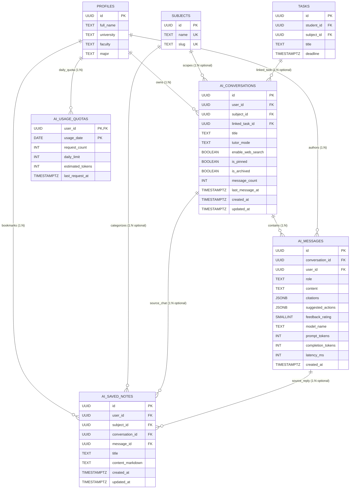

# AI Tutor — PostgreSQL / Supabase Database Model

**Project:** Smart Study Companion — Team 5 (Ulsan College Capstone Design)  
**Target Migration Slot:** `supabase/migrations/013_ai_tutor.sql` *(follows `011_study_streak_analytics.sql` and `012_quiz_difficulty_and_repetition.sql`)*  
**Security Model:** PostgreSQL Row Level Security (`auth.uid()` isolation) + Server-Side Quota Enforcement

---

## 1. Schema Overview & Dependencies

Reuses core identities and academic entities without duplicating catalogs:
- `public.profiles(id)` — Student owner (`auth.users.id`)
- `public.subjects(id)` — Academic course context (enrolled via `student_subjects`)
- `public.tasks(id)` — Optional study task context (`linked_task_id`)
- `public.update_updated_at()` — Shared trigger function from `001_profiles.sql`

Adds **4 normalized tables**:
1. `public.ai_conversations` — Tutor sessions, active pedagogical mode, web-search flag, pin/archive state, and cached message counts.
2. `public.ai_messages` — Ordered multi-turn chat messages (`user` / `assistant` / `system`), search citations, suggested follow-up actions, student rating, and token telemetry.
3. `public.ai_usage_quotas` — Per-student daily request caps & token usage (`(user_id, usage_date)` composite PK), readable by the student and mutated exclusively server-side.
4. `public.ai_saved_notes` — Bookmarked tutor explanations saved by subject for revision.

---

## 2. Entity Relationship Diagram (ERD)



---

## 3. Data Dictionary & RLS Summary

| Table | Primary Key | Key Constraints | RLS Access Rules |
| :--- | :--- | :--- | :--- |
| `public.ai_conversations` | `id (UUID)` | `title` 1–200 chars; `tutor_mode IN ('explain','socratic','exam_prep','summarize')`; `message_count >= 0` | Owner full CRUD (`auth.uid() = user_id`) |
| `public.ai_messages` | `id (UUID)` | `role IN ('user','assistant','system')`; `content` 1–20,000 chars; `feedback_rating IN (-1, 1)` | Owner `SELECT / INSERT / UPDATE` only when parent `ai_conversations.user_id = auth.uid()` |
| `public.ai_usage_quotas` | `(user_id, usage_date)` | `request_count >= 0`; `daily_limit > 0`; `estimated_tokens >= 0` | Student **`SELECT` only** (`auth.uid() = user_id`); Edge Function mutates with service role |
| `public.ai_saved_notes` | `id (UUID)` | `title` 1–200 chars; `content_markdown` 1–20,000 chars | Owner full CRUD (`auth.uid() = user_id`) |

---

## 4. SQL Migration (`013_ai_tutor.sql`)

```sql
-- ============================================================================
-- Migration 013: AI Tutor Schema, Indexes, Triggers & Row Level Security
-- ============================================================================
-- Depends on: 001_profiles.sql, 002_subjects.sql, 003_tasks.sql
-- ============================================================================

-- 1. AI CONVERSATIONS
CREATE TABLE IF NOT EXISTS public.ai_conversations (
    id                UUID PRIMARY KEY DEFAULT gen_random_uuid(),
    user_id           UUID NOT NULL REFERENCES public.profiles(id) ON DELETE CASCADE,
    subject_id        UUID NULL REFERENCES public.subjects(id) ON DELETE SET NULL,
    linked_task_id    UUID NULL REFERENCES public.tasks(id) ON DELETE SET NULL,
    title             TEXT NOT NULL DEFAULT 'New AI Tutor Chat'
                      CHECK (char_length(title) BETWEEN 1 AND 200),
    tutor_mode        TEXT NOT NULL DEFAULT 'explain'
                      CHECK (tutor_mode IN ('explain', 'socratic', 'exam_prep', 'summarize')),
    enable_web_search BOOLEAN NOT NULL DEFAULT false,
    is_pinned         BOOLEAN NOT NULL DEFAULT false,
    is_archived       BOOLEAN NOT NULL DEFAULT false,
    message_count     INT NOT NULL DEFAULT 0 CHECK (message_count >= 0),
    last_message_at   TIMESTAMPTZ NOT NULL DEFAULT now(),
    created_at        TIMESTAMPTZ NOT NULL DEFAULT now(),
    updated_at        TIMESTAMPTZ NOT NULL DEFAULT now()
);

COMMENT ON TABLE public.ai_conversations IS 'Multi-turn AI Tutor chat sessions anchored to optional student subject and task context';

CREATE INDEX IF NOT EXISTS idx_ai_conversations_user_activity
    ON public.ai_conversations (user_id, is_archived, is_pinned DESC, last_message_at DESC);

CREATE INDEX IF NOT EXISTS idx_ai_conversations_subject
    ON public.ai_conversations (user_id, subject_id);

-- 2. AI MESSAGES
CREATE TABLE IF NOT EXISTS public.ai_messages (
    id                UUID PRIMARY KEY DEFAULT gen_random_uuid(),
    conversation_id   UUID NOT NULL REFERENCES public.ai_conversations(id) ON DELETE CASCADE,
    user_id           UUID NOT NULL REFERENCES public.profiles(id) ON DELETE CASCADE,
    role              TEXT NOT NULL CHECK (role IN ('user', 'assistant', 'system')),
    content           TEXT NOT NULL CHECK (char_length(content) BETWEEN 1 AND 20000),
    citations         JSONB NOT NULL DEFAULT '[]'::jsonb,
    suggested_actions JSONB NOT NULL DEFAULT '[]'::jsonb,
    feedback_rating   SMALLINT NULL CHECK (feedback_rating IN (-1, 1)),
    model_name        TEXT NULL,
    prompt_tokens     INT NULL CHECK (prompt_tokens IS NULL OR prompt_tokens >= 0),
    completion_tokens INT NULL CHECK (completion_tokens IS NULL OR completion_tokens >= 0),
    latency_ms        INT NULL CHECK (latency_ms IS NULL OR latency_ms >= 0),
    created_at        TIMESTAMPTZ NOT NULL DEFAULT now()
);

COMMENT ON TABLE public.ai_messages IS 'Ordered conversation messages, grounded citations, student ratings, and token metadata';

CREATE INDEX IF NOT EXISTS idx_ai_messages_conversation_time
    ON public.ai_messages (conversation_id, created_at ASC);

CREATE INDEX IF NOT EXISTS idx_ai_messages_user
    ON public.ai_messages (user_id, created_at DESC);

-- 3. AI USAGE QUOTAS
CREATE TABLE IF NOT EXISTS public.ai_usage_quotas (
    user_id           UUID NOT NULL REFERENCES public.profiles(id) ON DELETE CASCADE,
    usage_date        DATE NOT NULL DEFAULT CURRENT_DATE,
    request_count     INT NOT NULL DEFAULT 0 CHECK (request_count >= 0),
    daily_limit       INT NOT NULL DEFAULT 30 CHECK (daily_limit > 0),
    estimated_tokens  INT NOT NULL DEFAULT 0 CHECK (estimated_tokens >= 0),
    last_request_at   TIMESTAMPTZ NULL,
    PRIMARY KEY (user_id, usage_date)
);

COMMENT ON TABLE public.ai_usage_quotas IS 'Server-enforced per-student daily AI Tutor usage counters and cooldown timestamps';

-- 4. AI SAVED STUDY NOTES
CREATE TABLE IF NOT EXISTS public.ai_saved_notes (
    id                UUID PRIMARY KEY DEFAULT gen_random_uuid(),
    user_id           UUID NOT NULL REFERENCES public.profiles(id) ON DELETE CASCADE,
    subject_id        UUID NULL REFERENCES public.subjects(id) ON DELETE SET NULL,
    conversation_id   UUID NULL REFERENCES public.ai_conversations(id) ON DELETE SET NULL,
    message_id        UUID NULL REFERENCES public.ai_messages(id) ON DELETE SET NULL,
    title             TEXT NOT NULL CHECK (char_length(title) BETWEEN 1 AND 200),
    content_markdown  TEXT NOT NULL CHECK (char_length(content_markdown) BETWEEN 1 AND 20000),
    created_at        TIMESTAMPTZ NOT NULL DEFAULT now(),
    updated_at        TIMESTAMPTZ NOT NULL DEFAULT now()
);

COMMENT ON TABLE public.ai_saved_notes IS 'Bookmarked AI Tutor explanations saved by students for revision';

CREATE INDEX IF NOT EXISTS idx_ai_saved_notes_user_subject
    ON public.ai_saved_notes (user_id, subject_id, created_at DESC);

-- ============================================================================
-- TRIGGERS
-- ============================================================================

DROP TRIGGER IF EXISTS ai_conversations_updated_at ON public.ai_conversations;
CREATE TRIGGER ai_conversations_updated_at
    BEFORE UPDATE ON public.ai_conversations
    FOR EACH ROW EXECUTE FUNCTION public.update_updated_at();

DROP TRIGGER IF EXISTS ai_saved_notes_updated_at ON public.ai_saved_notes;
CREATE TRIGGER ai_saved_notes_updated_at
    BEFORE UPDATE ON public.ai_saved_notes
    FOR EACH ROW EXECUTE FUNCTION public.update_updated_at();

CREATE OR REPLACE FUNCTION public.sync_ai_conversation_on_message()
RETURNS TRIGGER
LANGUAGE plpgsql
SECURITY DEFINER SET search_path = ''
AS $$
BEGIN
    UPDATE public.ai_conversations
    SET message_count   = message_count + 1,
        last_message_at = NEW.created_at,
        updated_at      = now()
    WHERE id = NEW.conversation_id;
    RETURN NEW;
END;
$$;

DROP TRIGGER IF EXISTS trg_ai_messages_sync_conversation ON public.ai_messages;
CREATE TRIGGER trg_ai_messages_sync_conversation
    AFTER INSERT ON public.ai_messages
    FOR EACH ROW EXECUTE FUNCTION public.sync_ai_conversation_on_message();

-- ============================================================================
-- ROW LEVEL SECURITY (RLS)
-- ============================================================================

ALTER TABLE public.ai_conversations ENABLE ROW LEVEL SECURITY;
ALTER TABLE public.ai_messages      ENABLE ROW LEVEL SECURITY;
ALTER TABLE public.ai_usage_quotas  ENABLE ROW LEVEL SECURITY;
ALTER TABLE public.ai_saved_notes   ENABLE ROW LEVEL SECURITY;

DROP POLICY IF EXISTS ai_conversations_own_all ON public.ai_conversations;
CREATE POLICY ai_conversations_own_all ON public.ai_conversations
    FOR ALL
    USING (auth.uid() = user_id)
    WITH CHECK (auth.uid() = user_id);

DROP POLICY IF EXISTS ai_messages_select_own ON public.ai_messages;
CREATE POLICY ai_messages_select_own ON public.ai_messages
    FOR SELECT
    USING (
        auth.uid() = user_id
        AND EXISTS (
            SELECT 1 FROM public.ai_conversations c
            WHERE c.id = ai_messages.conversation_id
              AND c.user_id = auth.uid()
        )
    );

DROP POLICY IF EXISTS ai_messages_insert_own ON public.ai_messages;
CREATE POLICY ai_messages_insert_own ON public.ai_messages
    FOR INSERT
    WITH CHECK (
        auth.uid() = user_id
        AND EXISTS (
            SELECT 1 FROM public.ai_conversations c
            WHERE c.id = ai_messages.conversation_id
              AND c.user_id = auth.uid()
        )
    );

DROP POLICY IF EXISTS ai_messages_update_own ON public.ai_messages;
CREATE POLICY ai_messages_update_own ON public.ai_messages
    FOR UPDATE
    USING (
        auth.uid() = user_id
        AND EXISTS (
            SELECT 1 FROM public.ai_conversations c
            WHERE c.id = ai_messages.conversation_id
              AND c.user_id = auth.uid()
        )
    )
    WITH CHECK (auth.uid() = user_id);

DROP POLICY IF EXISTS ai_usage_quotas_select_own ON public.ai_usage_quotas;
CREATE POLICY ai_usage_quotas_select_own ON public.ai_usage_quotas
    FOR SELECT
    USING (auth.uid() = user_id);

DROP POLICY IF EXISTS ai_saved_notes_own_all ON public.ai_saved_notes;
CREATE POLICY ai_saved_notes_own_all ON public.ai_saved_notes
    FOR ALL
    USING (auth.uid() = user_id)
    WITH CHECK (auth.uid() = user_id);
```
